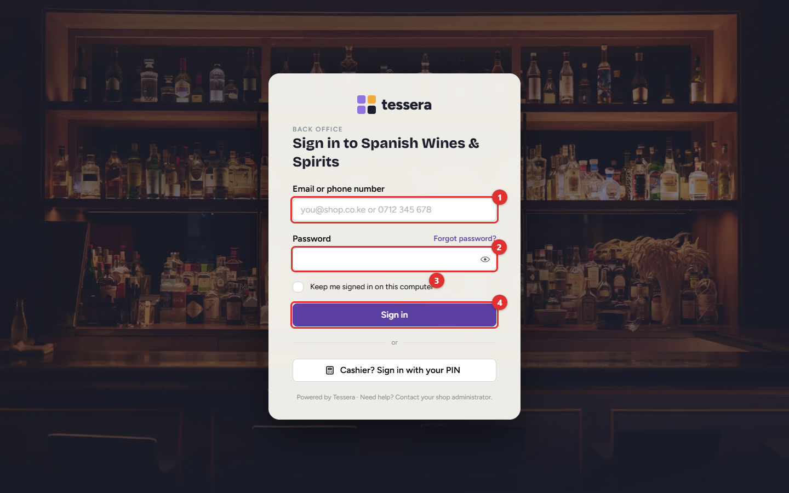
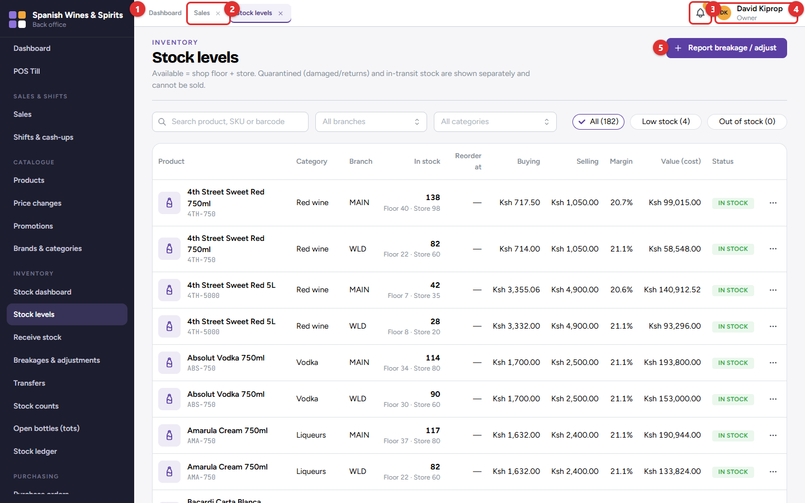
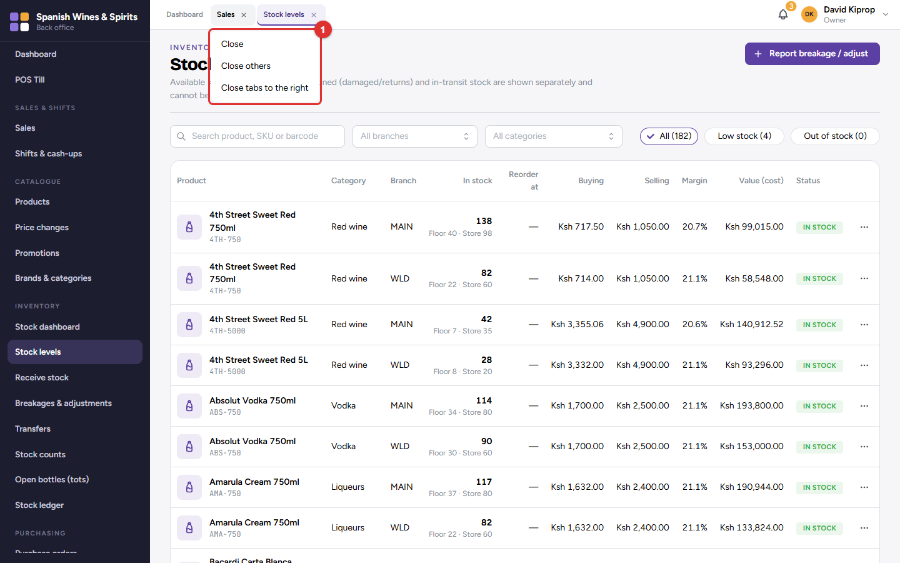
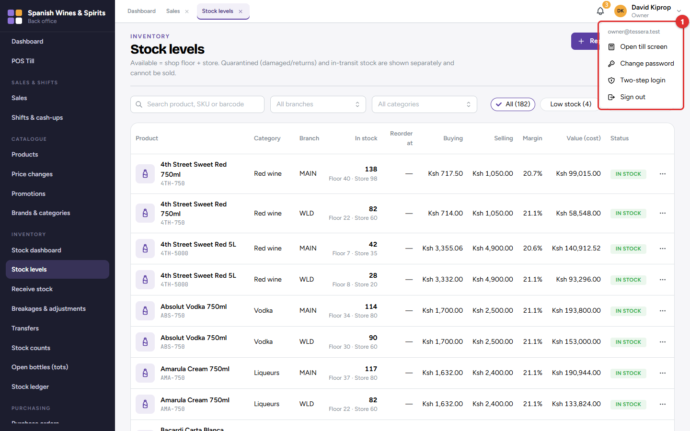

# 1. Getting started

Tessera POS runs in a web browser. There is nothing to install on the office computer: open the address Tessera gave you (for example `https://pos.yourshop.co.ke`) in Google Chrome or Microsoft Edge. The till runs in the same browser, full screen, on the computer or tablet at the counter.

There are two ways in:

| Who | Where they sign in | How |
| --- | --- | --- |
| Owner, admin, branch manager, storekeeper, accountant | The **back office** | Email or phone number, and a password |
| Cashier | The **till** | Tap their name and enter a four-digit PIN |

The examples in this guide use **Spanish Wines & Spirits** at Kobil Imara Daima, with a second branch in Westlands. The people, phone numbers and KRA PINs in the pictures are made up.

## Signing in to the back office

1. Type your email address or phone number **(1)**.
2. Type your password **(2)**. Passwords are case-sensitive.
3. Tick **Keep me signed in on this computer (3)** only on a computer nobody else uses.
4. Click **Sign in (4)**.

The first time you sign in, or when your password has expired, you are asked to choose a new one. Owners and admins may also be asked for a six-digit code from an authenticator app on their phone (**two-step login**). This protects the accounts that can change prices and see the money.

> **Tip:** Forgot your password? The owner or an administrator sets a new one for you under **Administration → Users & roles**. There is no reset by email.

> **Important:** The back office signs you out after 30 minutes without use, so an unattended computer is not left open.

## The screen

| Part | What it does |
| --- | --- |
| **Menu (1)** | The navy bar on the left, with the shop name at the top. It lists only what your role allows you to use. Click an item to open it. |
| **Tabs (2)** | Each screen you open gets a tab at the top, like a web browser. Click a tab to go back to that screen; it is exactly as you left it, filters and all. |
| **Notifications (3)** | The bell shows alerts: low stock, cash shortages, licences about to expire, eTIMS problems. The number is how many you have not read. |
| **Account menu (4)** | Your name. Opens the till, changes your password or two-step login, and signs you out. |
| **The screen itself** | Its title and a short explanation on the left, and its own buttons at the top right **(5)**. |

Right-click a tab **(1)** to close it, close the others, or close the tabs to its right. You can also click the small **×** on the tab.

The account menu **(1)** has:

- **Open till screen:** turns this computer into the till (only if it has been set up as one; see chapter 3).
- **Change password** and **Two-step login**.
- **Sign out.** Always sign out on a shared computer.

## Who can do what

Each person has one **role**. The role decides which menu items they see and what they may do. A few actions always need a second person (for example, approving a purchase order or a price change), so that no one can both make and approve a change.

| Role | Typical person | Main jobs |
| --- | --- | --- |
| **Owner** | The business owner | Everything, and approves prices, promotions and large changes |
| **Admin** | Office manager | Set-up, products, staff and purchasing |
| **Branch Manager** | Shop manager | Runs a branch: approves discounts, refunds, adjustments and cash-ups |
| **Cashier** | Counter staff | Sells at the till only |
| **Storekeeper** | Stock clerk | Receives deliveries, counts stock, records breakages and transfers |
| **Accountant** | Bookkeeper | Purchase orders, supplier bills and payments, expenses, reports |

> **Common mistake:** Sharing a sign-in or a PIN. Everything is recorded against the person who is signed in, including refunds and cash counts. Give everyone their own account.

## Getting help

- Each screen has a short explanation under its title.
- Hover over a small **ⓘ** or **More** button to read what a setting does.
- For anything else, contact Tessera support with the screen name and, if possible, a photo of the screen.
