# 3. Selling at the till

The till is the screen at the counter. It fills the whole screen and is made for touch, a mouse or a barcode scanner. This chapter covers setting a computer up as a till, signing in, and making a sale from start to finish.

**Who:** cashiers, and anyone else with a till PIN (managers and the owner). **Where:** the till computer.

## Setting up a computer as a till (once)

A computer or tablet becomes a till once. After that it opens straight to the cashier sign-in.

1. On the till computer, open the Tessera address and add `/till` at the end (or choose **Open till screen** from the account menu).
2. Click **Manager sign in** and sign in as the owner or an admin.

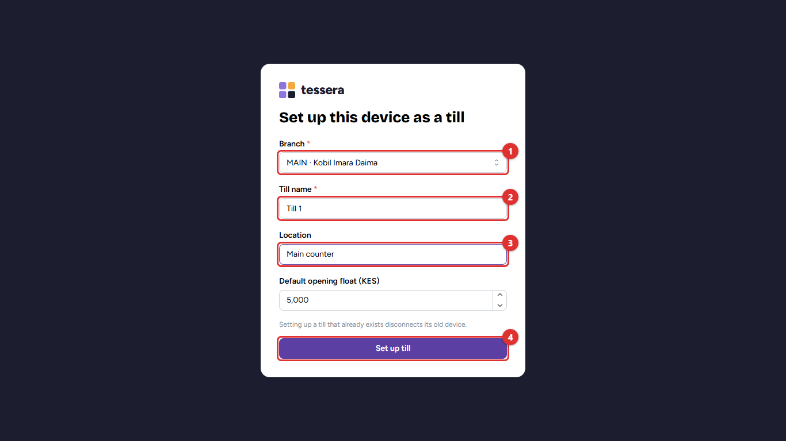

3. Choose the **Branch (1)** the till belongs to.
4. Give it a **Till name (2)**, such as *Till 1*, and say where it is **(3)**, such as *Main counter*.
5. Check the opening float, then click **Set up till (4)**.

> **Tip:** If a computer breaks, set up the new one with the same till name. The old computer stops working as that till straight away.

To stop a lost or stolen computer from selling, the owner clicks **Disconnect** next to the till under **Administration → Branches** (chapter 12).

## Signing in and starting the shift

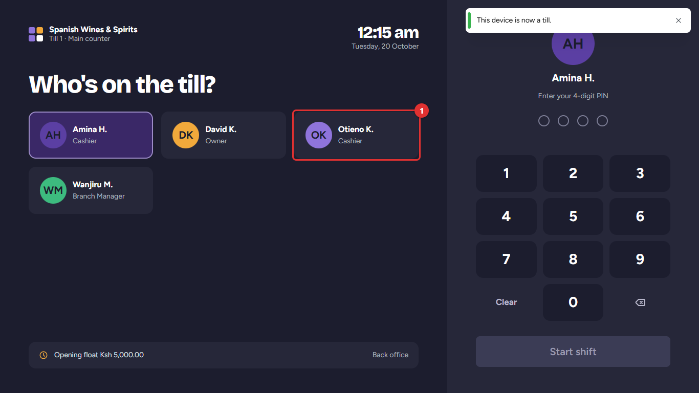

1. Tap your name **(1)**.

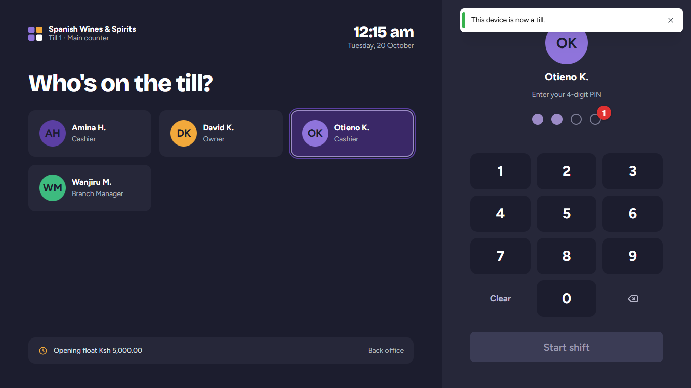

2. Type your four-digit PIN on the keypad or the keyboard. A dot fills in for each digit **(1)**.
3. Tap **Start shift**. If you already have a shift open on this till, you carry on where you left off.

> **Common mistake:** A cashier can have only one shift open at a time. If the till says *You still have an open shift on Till 1*, go back to that till, or end that shift first.

## The selling screen

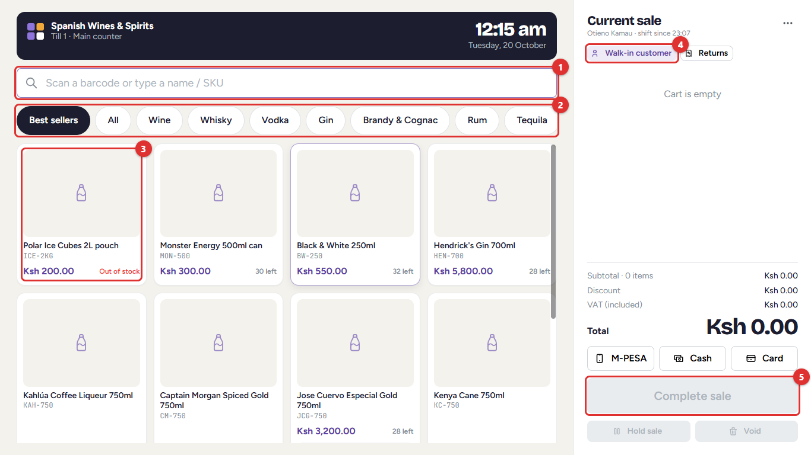

| Part | What it does |
| --- | --- |
| **Search box (1)** | Scan a barcode, or type part of a name or the product code (SKU). |
| **Categories (2)** | *Best sellers* shows this week's most sold items. Tap a category (Wine, Whisky, Vodka…) or *All* to browse. |
| **Product cards (3)** | Tap a card to add one to the sale. Each card shows the price and how many are left on the shop floor. *Out of stock* is shown in red. |
| **Customer (4)** | *Walk-in customer* unless you choose a registered customer. |
| **Complete sale (5)** | Takes the payment. It is greyed out until the sale has an item. |

At the top, the till shows the shop, the till's name and the time. On the right, the current sale lists every item with the total, the discount and the VAT included.

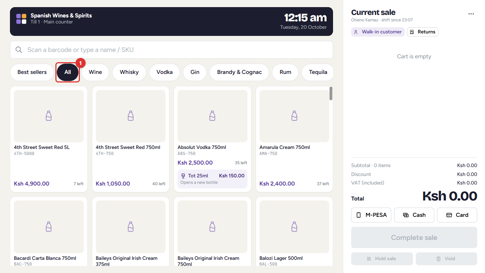

## Adding items

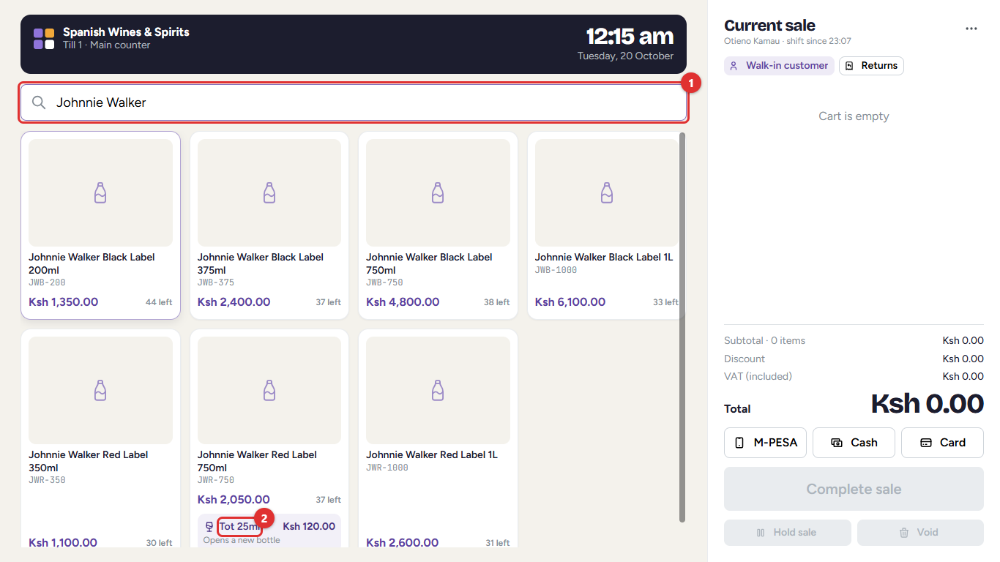

1. Scan the barcode, or type part of the name in the search box **(1)**. Only matching items are shown.
2. Tap the item you want.
3. To sell a **tot** (a measure poured from an open bottle), tap the tot button on the card **(2)**. The first tot opens a new bottle; the system keeps track of how much is left (chapter 7, *Open bottles*).

Scanning the same barcode again adds one more.

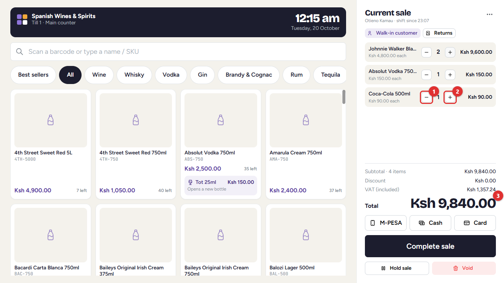

- Tap **−  (1)** or **+ (2)** to change how many.
- The **total (3)** updates straight away. Promotions are taken off by themselves, with their name under the item.

## Changing an item, giving a discount

Tap an item's name in the sale to change it.

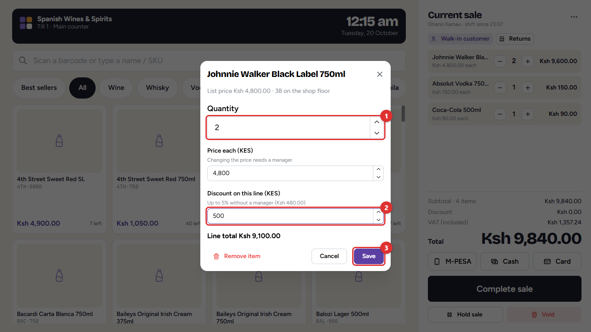

1. Change the **Quantity (1)**.
2. Type a **Discount (2)** in shillings. The note under the box shows how much you may give without a manager (here up to 5%).
3. Tap **Save (3)**. **Remove item** takes it off the sale.

Changing the **Price each** always needs a manager.

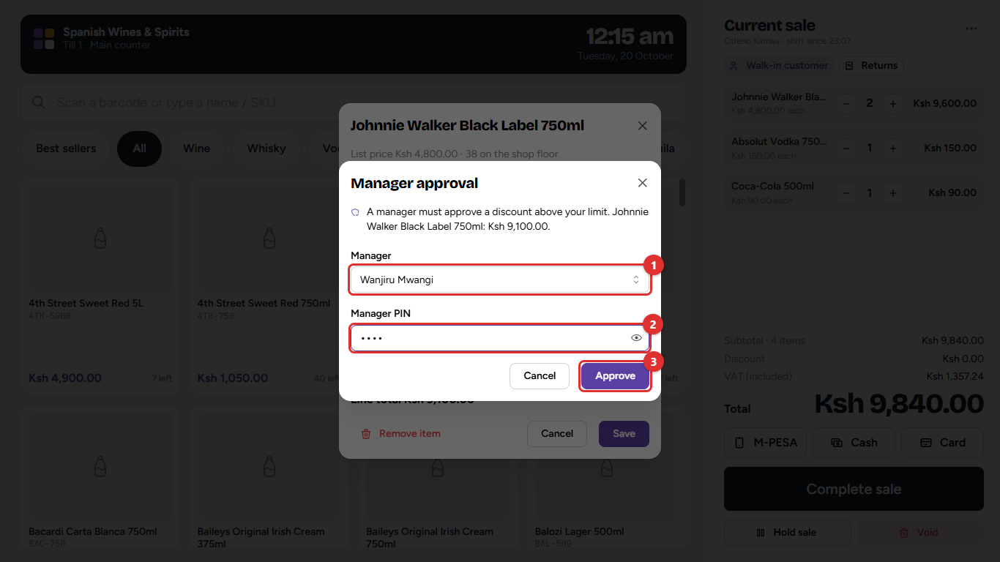

When a discount or price change is over your limit, a manager comes to the till, chooses their name **(1)**, types their PIN **(2)** and taps **Approve (3)**. The sale then shows who approved it.

> **Important:** The manager types the PIN, not the cashier. Every approval is recorded with the manager's name and appears in the *Voids, discounts & price overrides* report.

## Choosing a customer

Most sales are to walk-in customers. Choose a registered customer when:

- the customer is a **wholesale** buyer (they get wholesale prices);
- the sale goes **on account** (the customer pays later);
- the customer wants a **tax invoice** with their KRA PIN.

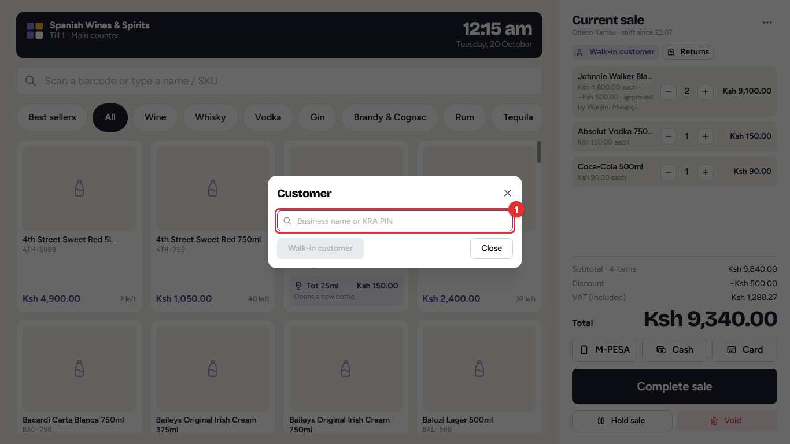

Tap **Walk-in customer**, then type the business name or KRA PIN **(1)** and tap the customer. Customers are registered in the back office (chapter 9).

## The till menu

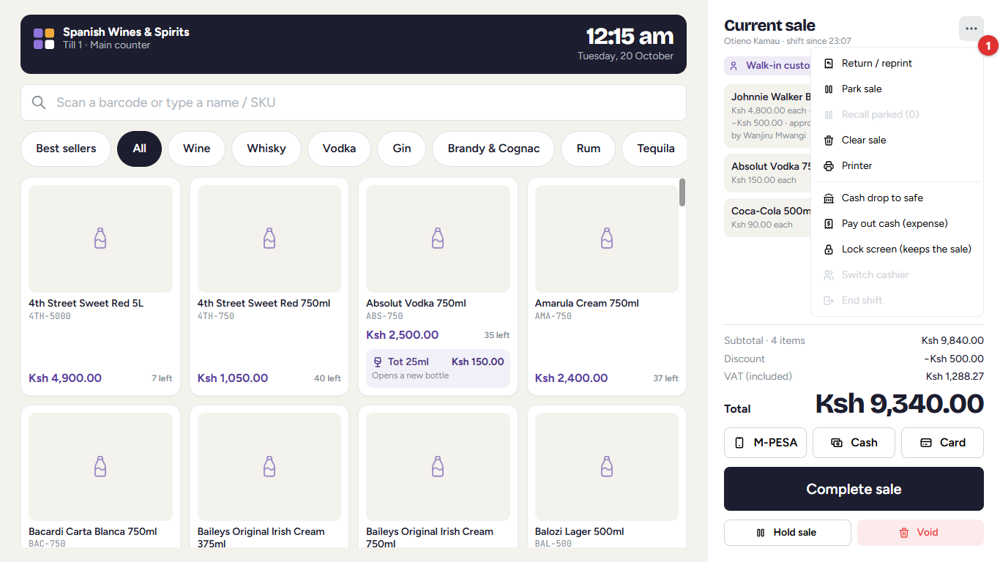

The **⋯** button next to *Current sale* opens the till menu **(1)**. *Return / reprint*, *Cash drop*, *Pay out*, *Lock screen*, *Switch cashier* and *End shift* are covered in chapter 4. Here:

- **Park sale:** put the sale on hold (see below).
- **Recall parked:** bring a held sale back.
- **Clear sale:** empty the sale and start again.
- **Printer:** check the receipt printer.

## Taking payment

1. Under the total, tap how the customer pays (**M-PESA**, **Cash** or **Card**). You can also leave it and choose on the next screen.
2. Tap **Complete sale**.

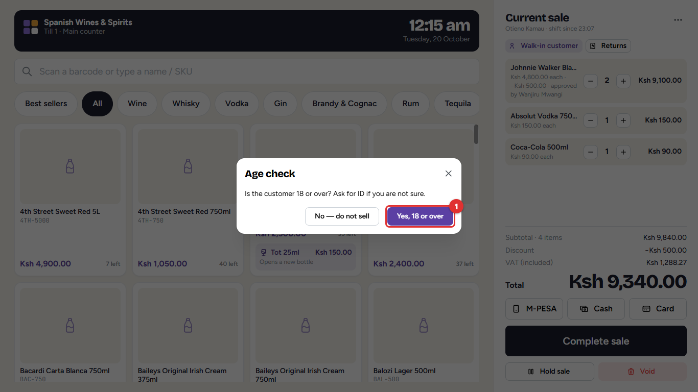

3. If the sale includes alcohol, the till asks whether the customer is 18 or over. Ask for ID if you are not sure, then tap **Yes, 18 or over (1)**. If they are not, tap **No — do not sell**.

### Cash

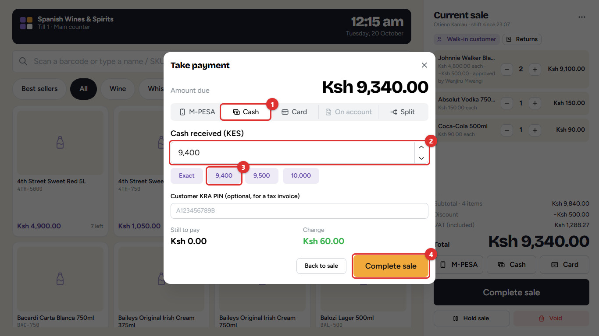

1. **Cash (1)** is selected.
2. Type what the customer gives you **(2)**, or tap a quick amount **(3)**: *Exact* or the next round notes.
3. The till shows the **Change** to give. Tap **Complete sale (4)**.

If the shop rounds cash to the nearest shilling amount, the till shows the rounded amount to collect.

### M-PESA

Choose **M-PESA**, type the customer's phone number and tap **Send request**. The customer approves the payment on their phone with their M-PESA PIN. When *M-PESA received* appears, tap **Complete sale**. Chapter 2 (Step 4) shows each screen.

If the customer has already paid to the till number, choose the payment from the list of payments received instead of sending a request.

### Card

Choose **Card**, take the payment on the card machine, then type the machine's **approval code** (and, if you like, the last four digits of the card) and tap **Complete sale**.

### On account

Only for a registered customer with a credit account. The till shows how much credit is available. The amount is added to what the customer owes (chapter 9).

### Split payment

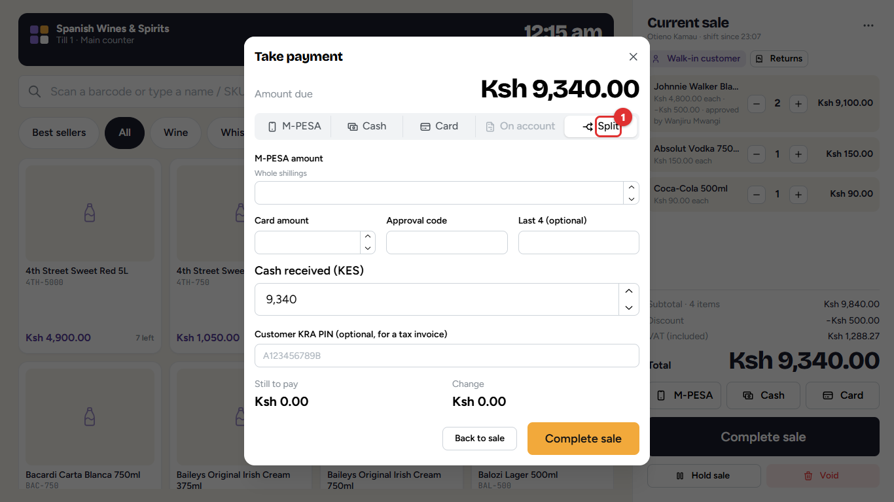

Choose **Split (1)** when the customer pays part in cash and part by M-PESA or card. Enter each amount; *Still to pay* must reach zero.

### A tax invoice for a business

Type the customer's KRA PIN in **Customer KRA PIN** on the payment screen. The eTIMS invoice then carries the PIN, so the business can claim the VAT.

## Sale complete: the receipt

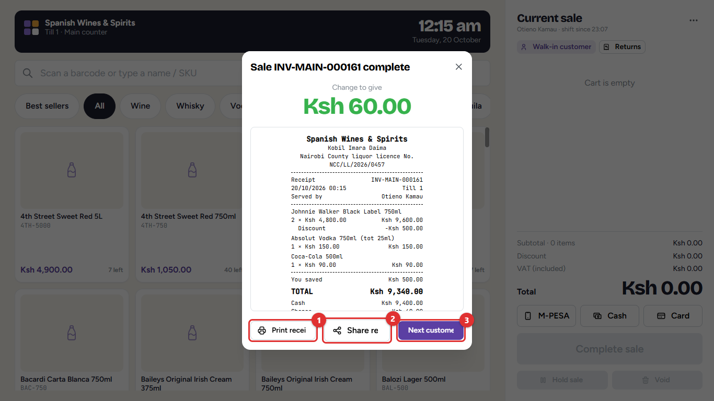

The till shows the change to give in large figures, and the receipt.

- **Print receipt (1)** prints it on the receipt printer.
- **Share receipt (2)** gives the customer a link instead of paper.
- **Next customer (3)** clears the screen for the next sale.

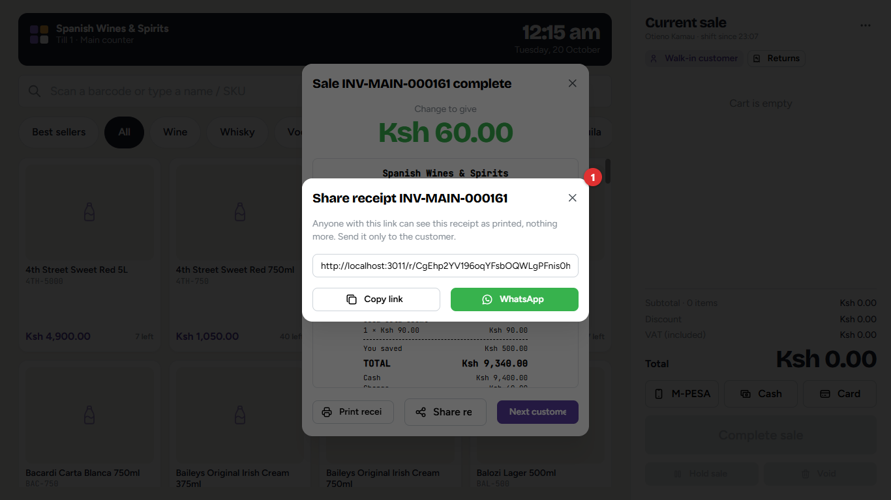

The link **(1)** opens the receipt on the customer's phone, exactly as printed. Tap **Copy link**, or **WhatsApp** to send it in a WhatsApp message. Send it only to the customer.

The tax invoice is sent to KRA's eTIMS automatically. If the receipt says *eTIMS invoice pending*, KRA's signature follows a few seconds later; reprint the receipt if the customer needs it.

## Holding a sale (park and recall)

When a customer goes back to fetch something, park their sale and serve the next person.

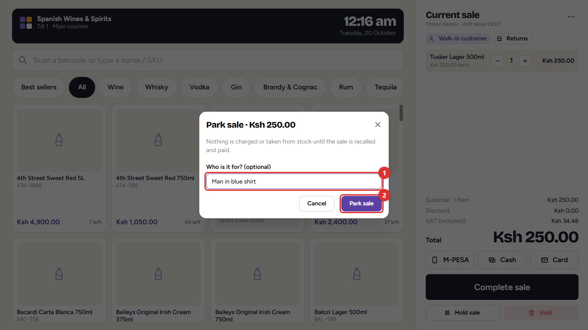

1. Tap **Hold sale** (under *Complete sale*), or **Park sale** in the till menu.
2. Type a note so you can find it again **(1)**, for example *Man in blue shirt*.
3. Tap **Park sale (2)**.

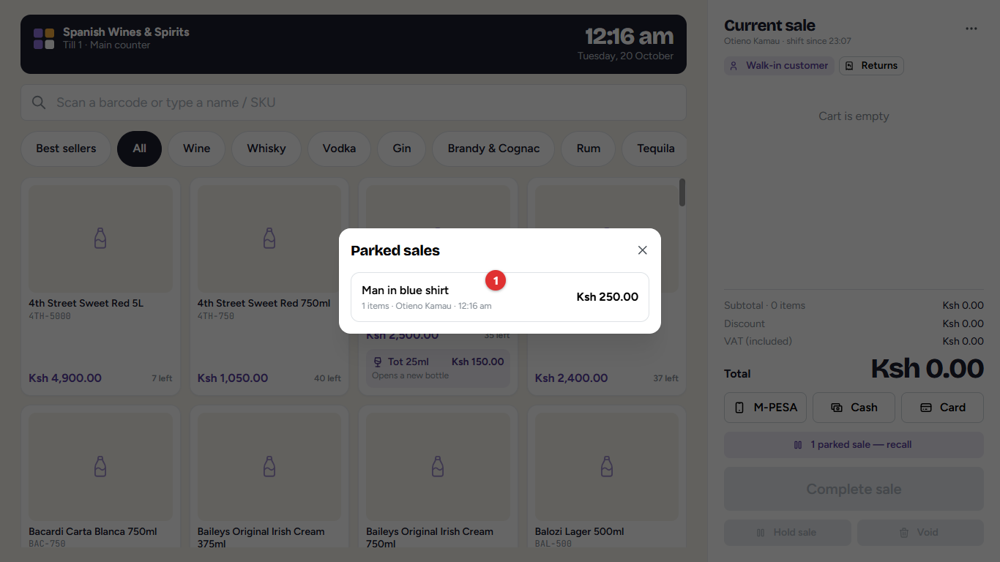

To bring it back, tap **1 parked sale — recall** above *Complete sale*, or **Recall parked** in the till menu, and tap the sale **(1)**.

## Removing everything: Void

**Void** (next to *Hold sale*) clears the whole sale. A manager's PIN is needed when the sale is above the amount set by the owner. Every void is recorded in the *Voids, discounts & price overrides* report.

## When the internet is down

The till keeps selling. A yellow banner says *Offline — still selling*.

- **Cash** and **card** work as usual.
- **M-PESA:** ask the customer to pay to the till number, check the amount on their message, and type the M-PESA code from it. The code is checked with Safaricom when the connection is back; a manager is told if it cannot be confirmed.
- Returns, M-PESA payment requests, manager approvals and ending the shift wait for the connection.

Offline sales are saved on the till and sent by themselves when the connection is back. Do not close the browser or switch the computer off until the banner says they have been sent.

> **Common mistake:** Clearing the browser's history or data on the till while it has offline sales waiting. Those sales would be lost. Wait until they have been sent.

## Outside licensed hours

If the owner has switched on the licensed-hours lock, the till shows *Outside licensed hours: alcohol cannot be sold* and refuses alcohol until the licensed hours start again. Soft drinks, water and other items can still be sold.
