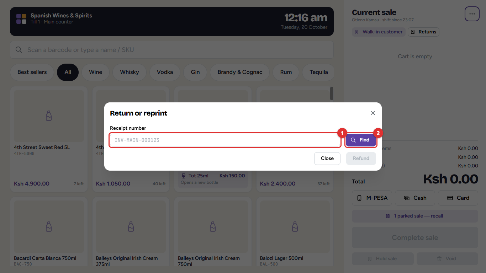
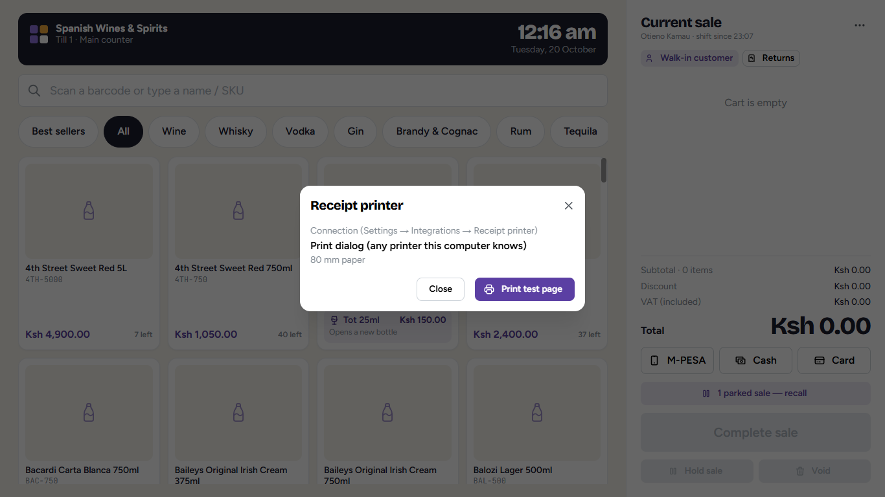
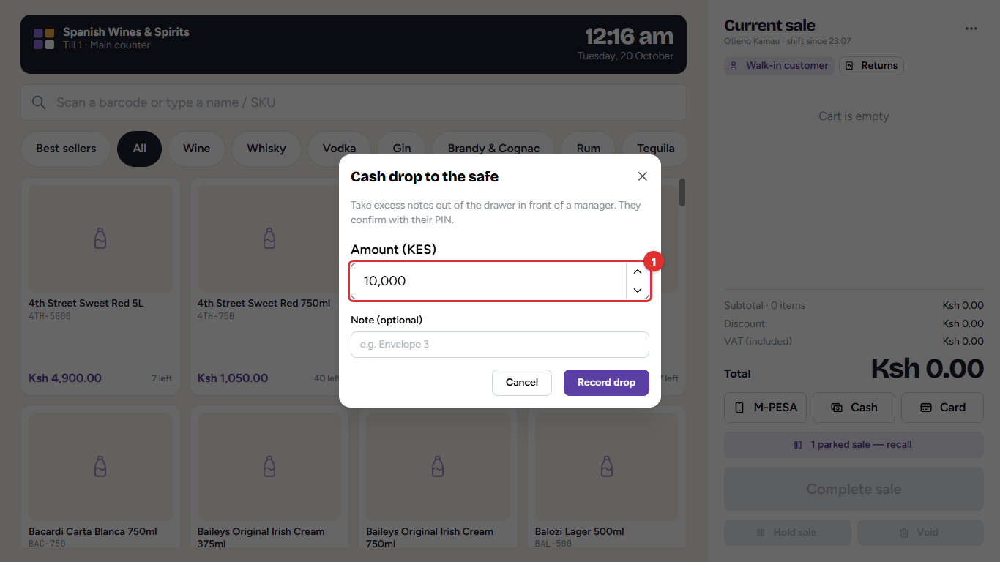
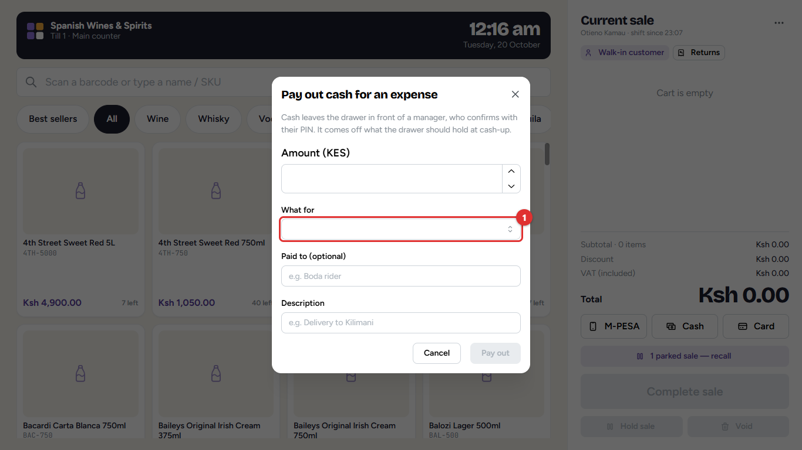
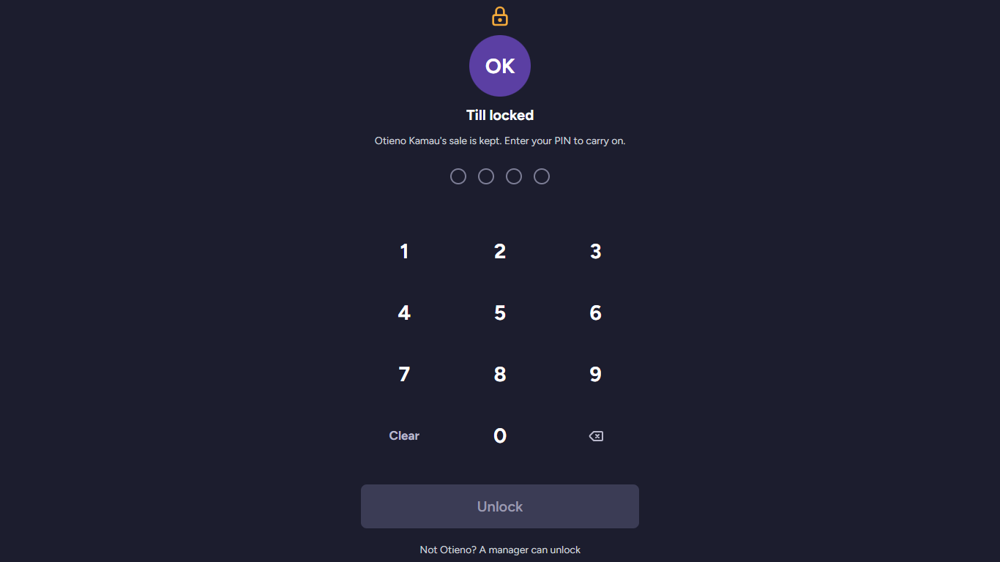
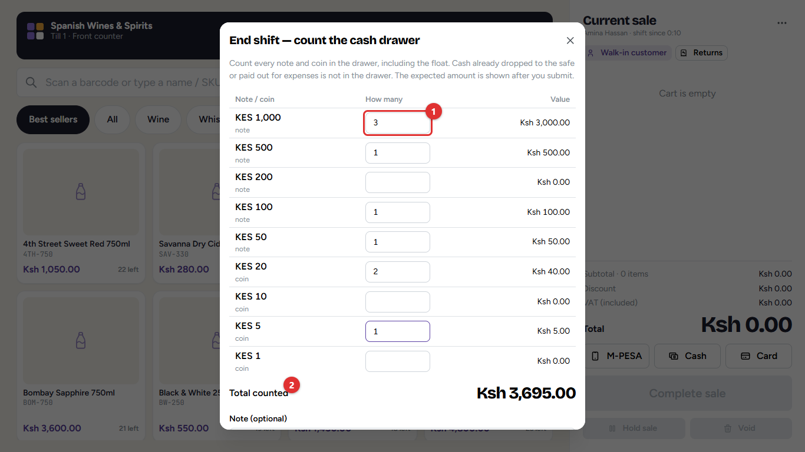
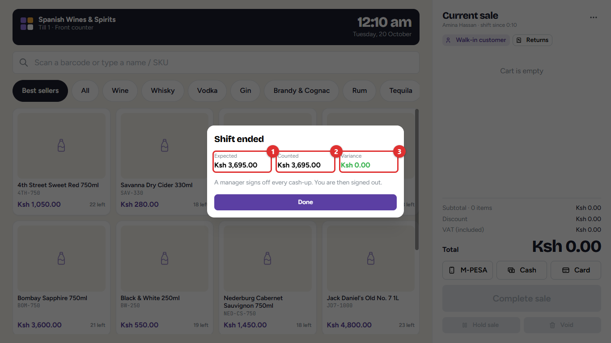

# 4. During and after a shift

This chapter covers everything at the till that is not a sale: returns and reprints, the receipt printer, moving cash to the safe, paying for small expenses from the drawer, leaving the till, handing over to another cashier, and counting the cash at the end of the shift.

**Who:** cashiers, with a manager for the steps that need a witness. **Where:** the till menu (the **⋯** button next to *Current sale*).

## Returns and reprints

Open the till menu and choose **Return / reprint** (or tap **Returns** under *Current sale*).

1. Type the **receipt number (1)** from the customer's receipt, for example *INV-MAIN-000161*, and tap **Find (2)**.
2. To print another copy, tap **Reprint receipt**. You can stop here.
3. For a return, enter how many of each item come back.
4. Tick **Sealed** for a bottle that is unopened and can go back on the shelf. Leave it unticked for an opened, broken or faulty item: it goes to a separate *quarantine* area for the manager to check, and is not sold again by mistake.
5. Type the **Reason**, then tap **Refund**.
6. If the shop's settings ask for it, a manager approves the refund with their PIN.

The refund is paid **in cash from the drawer**, even when the customer paid by M-PESA or card. The till says how much to give back. Chapter 2 (Step 7) shows each screen of a return.

**What changes elsewhere:** the stock goes back, a credit note is sent to eTIMS, and the expected cash for the shift goes down by the refund.

> **Important:** Returns are accepted only for a set number of days after the sale (the owner sets this). After that, the till says returns are closed for that sale.

## The receipt printer

Till menu → **Printer** shows how this till prints and lets you **Print test page**. If the printer is connected directly (USB or serial), the window also has buttons to connect it and to test the **cash drawer**.

How each till prints is chosen by the owner under **Administration → Settings → Integrations → Receipt printer** (chapter 12).

> **Tip:** If nothing prints, check that the printer is on, has paper and is plugged in, then print a test page. Receipts can always be reprinted from *Return / reprint*.

## Cash drop to the safe

Too much cash in the drawer is a risk. During the shift, move some to the safe.

1. Till menu → **Cash drop to safe**.
2. Type the **Amount (1)** and, if you like, a note such as the envelope number.
3. A manager witnesses the drop with their PIN.

The drop is taken off the cash expected in the drawer at the end of the shift.

## Paying out cash for an expense

For a small expense paid from the drawer, such as a boda rider for a delivery:

1. Till menu → **Pay out cash (expense)**.
2. Type the amount, choose **What for (1)** (the expense category), who was paid, and a short description.
3. A manager witnesses the payout with their PIN.

The payout is recorded as an expense (chapter 10) and taken off the cash expected in the drawer.

## Leaving the till: lock screen

Till menu → **Lock screen (keeps the sale)** locks the till while you step away. The till also locks itself after a short time without use.

- To carry on, type your PIN and tap **Unlock**. The sale is exactly as you left it.
- If you cannot come back, a manager taps **Not *(name)*? A manager can unlock**, chooses their name and types their PIN.

## Handing over: switch cashier

Till menu → **Switch cashier** goes back to *Who's on the till?* without ending your shift, so another cashier can sign in with their own PIN. The sale must be empty first (complete, park or clear it).

> **Common mistake:** Selling on someone else's shift. Each sale and every shilling in the drawer belongs to the cashier who is signed in. Always switch cashier, never "just use" the open screen.

## Ending the shift: counting the cash

At the end of the shift, the cashier counts the drawer. The sale must be empty, and any offline sales must have been sent.

1. Till menu → **End shift**.
2. Enter how many of each note and coin are in the drawer **(1)**. The total **(2)** adds up as you type.
3. Add a note if something needs explaining, and tap **Submit count (3)**.

The till does **not** show how much it expected until the count is submitted, so the count is honest.

The till then shows:

| Line | Meaning |
| --- | --- |
| **Expected (1)** | Opening float + cash sales − cash refunds − cash drops − payouts |
| **Counted (2)** | What you counted |
| **Variance / Short / Over (3)** | The difference. Zero means the drawer balances. |

If the drawer is short or over, the cashier must type **why** before finishing (for example *Gave KES 100 too much change to a customer*). Tap **Done**. The till goes back to *Who's on the till?*.

**What changes elsewhere:** the cash-up waits for a manager's sign-off under **Sales & Shifts → Shifts & cash-ups** (chapter 5). A shortage is shown on the dashboard and sent as an alert.

## At a glance

| Task | Where | Needs a manager? |
| --- | --- | --- |
| Reprint a receipt | Till menu → Return / reprint | No |
| Return or refund | Till menu → Return / reprint | Yes, if the shop's settings say so |
| Test the printer | Till menu → Printer | No |
| Cash to the safe | Till menu → Cash drop to safe | Yes (witness) |
| Small expense from the drawer | Till menu → Pay out cash (expense) | Yes (witness) |
| Step away | Till menu → Lock screen | Only if you cannot unlock it yourself |
| Hand over | Till menu → Switch cashier | No |
| End of shift | Till menu → End shift | Signs off the cash-up afterwards |
