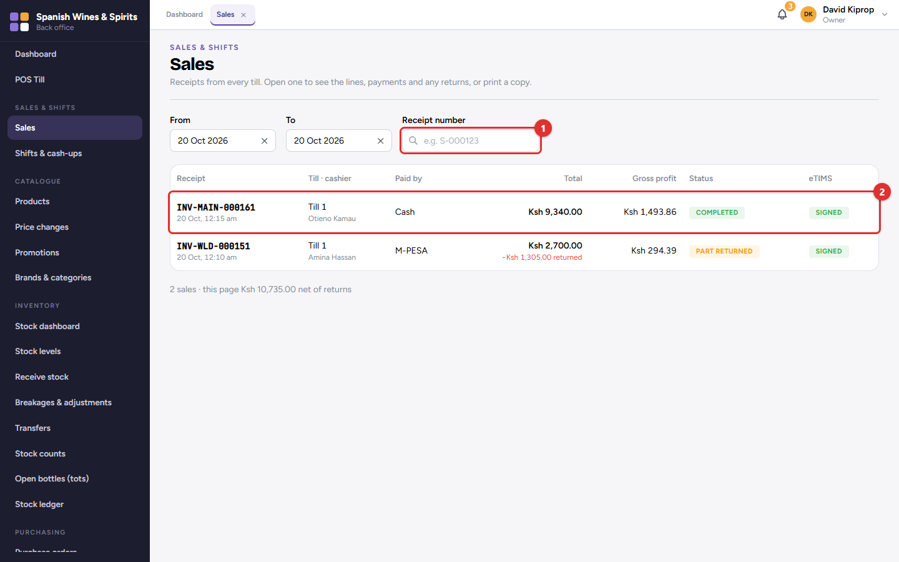
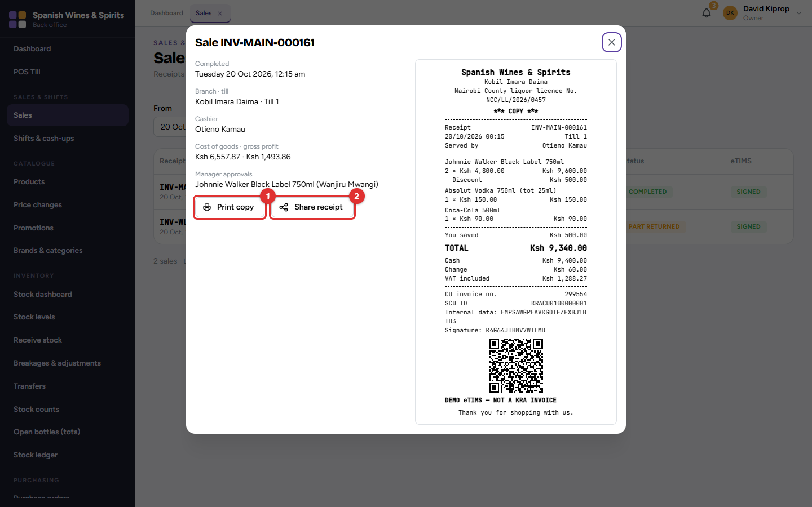
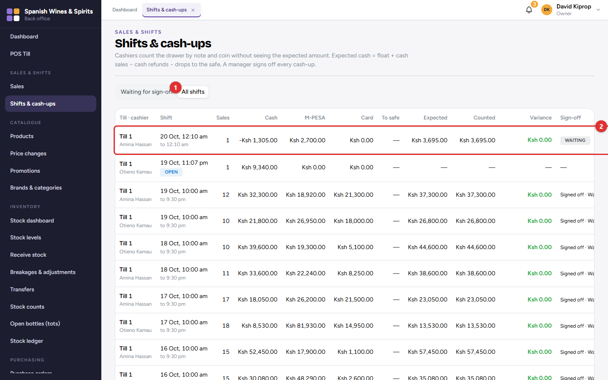
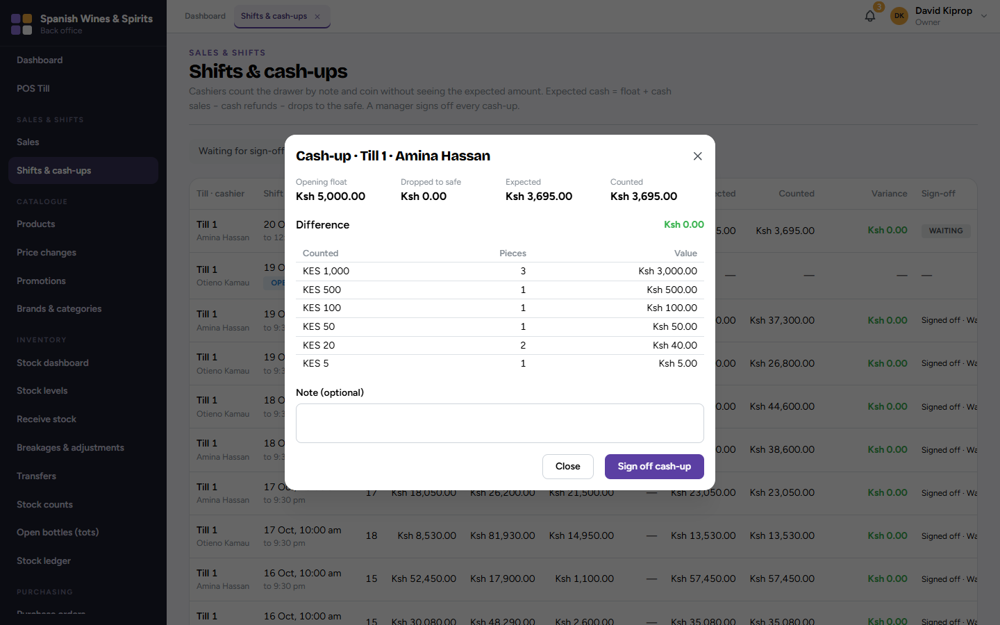

# 5. Sales and cash-ups

Every sale made at any till, and every shift's cash count, can be looked at from the back office. This is where a manager finds a receipt, checks a refund and signs off the cash-ups.

**Who:** owner, admin, branch managers and the accountant (managers see only their own branches). **Where:** **Sales & Shifts → Sales** and **Shifts & cash-ups**.

## Finding a sale

The list opens on today's sales. Change the **From** and **To** dates to look further back, or type a **Receipt number (1)** to go straight to one sale.

Each row **(2)** shows:

| Column | Meaning |
| --- | --- |
| **Receipt** | The receipt number and time. The middle part is the branch (for example *MAIN* or *WLD*). |
| **Till · cashier** | Which till, and who was signed in. |
| **Paid by** | Cash, M-PESA, card, on account, or split. |
| **Total** | What the customer paid. Any amount returned later is shown in red underneath. |
| **Gross profit** | The total less VAT and the cost of the goods (shown only to people allowed to see profit). |
| **Status** | *Completed*, *Part returned* or *Returned*. |
| **eTIMS** | *Signed* when KRA has signed the invoice; *Pending* for a few seconds after the sale. |

Under the list, the number of sales and their total, net of returns.

Click a sale to see its items, payments, VAT, any returns and the eTIMS invoice number. From here:

- **Print copy (1)** prints the receipt again.
- **Share receipt (2)** creates a link to send to the customer (see chapter 3).

> **Important:** A completed sale can never be edited or deleted. A mistake is corrected with a return at the till, which keeps a full record of what happened.

## Checking and signing off cash-ups

At the end of every shift, the cashier counts the drawer (chapter 4). A manager then checks the count and signs it off.

The screen opens on **Waiting for sign-off (1)**. Choose **All shifts** to see every shift, including the ones still open.

Each row **(2)** shows the till, the cashier, when the shift ran, the number of sales, the takings by cash, M-PESA and card, the cash moved to the safe, and:

| Column | Meaning |
| --- | --- |
| **Expected** | Opening float + cash sales − cash refunds − cash drops − payouts. |
| **Counted** | What the cashier counted. |
| **Variance** | Counted − expected. Green when the drawer balances. |
| **Sign-off** | *Waiting*, or who signed it off and when. |

1. Click a row to open the cash-up. It shows the float, cash to the safe, expected and counted, and every note and coin counted.
2. If the cashier gave a reason for a difference, it is shown here.
3. Add a note if needed, then click **Sign off cash-up**.

> **Tip:** Sign off cash-ups every day. A shortage is easier to explain the same evening than a week later.

> **Common mistake:** Treating a small overage as good news. Cash over usually means a sale was not rung up, or the wrong change was given. Ask the cashier.

**What changes elsewhere:** signed-off cash-ups appear in the *Shift cash-up & variance* report (chapter 11). A shortage also raises an alert for the owner and managers.
