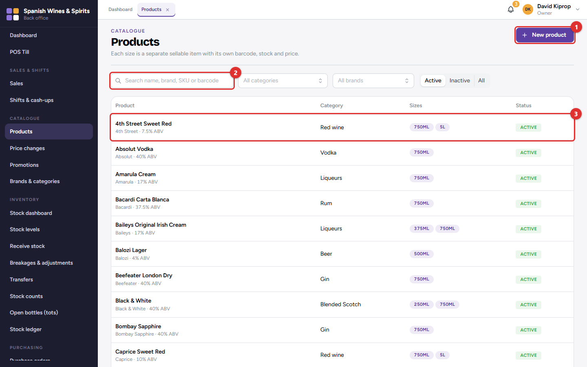
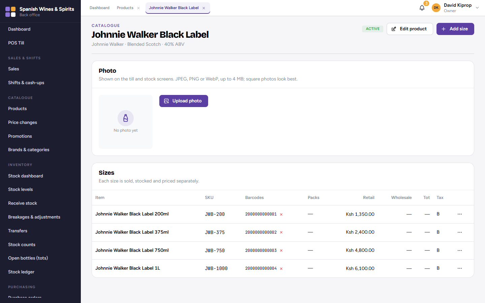
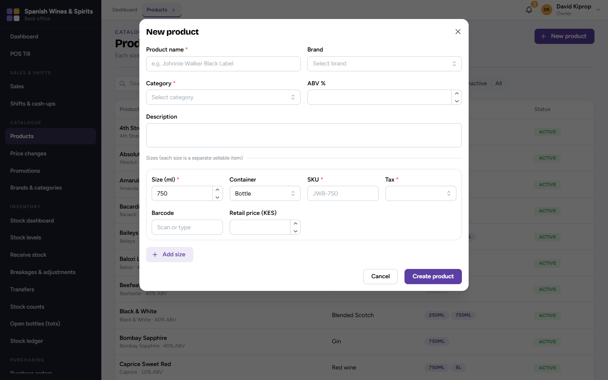
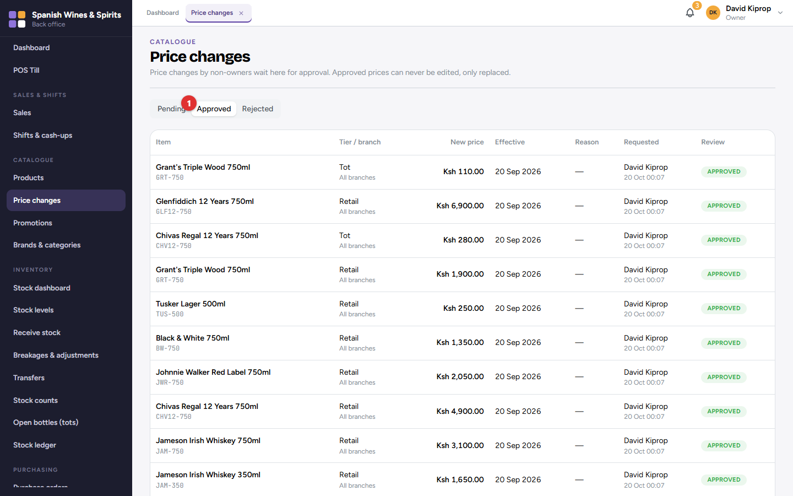
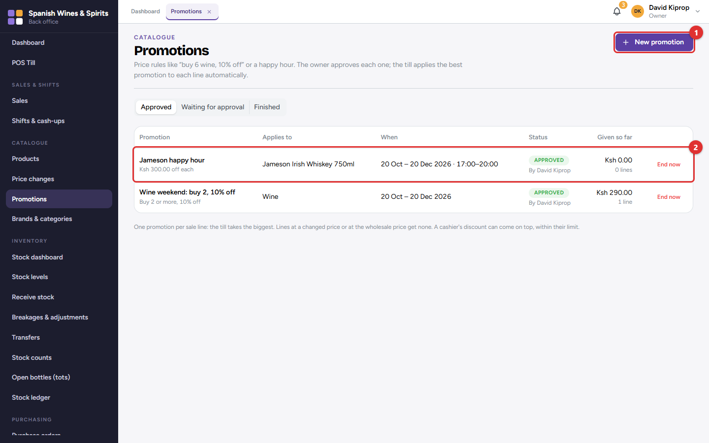
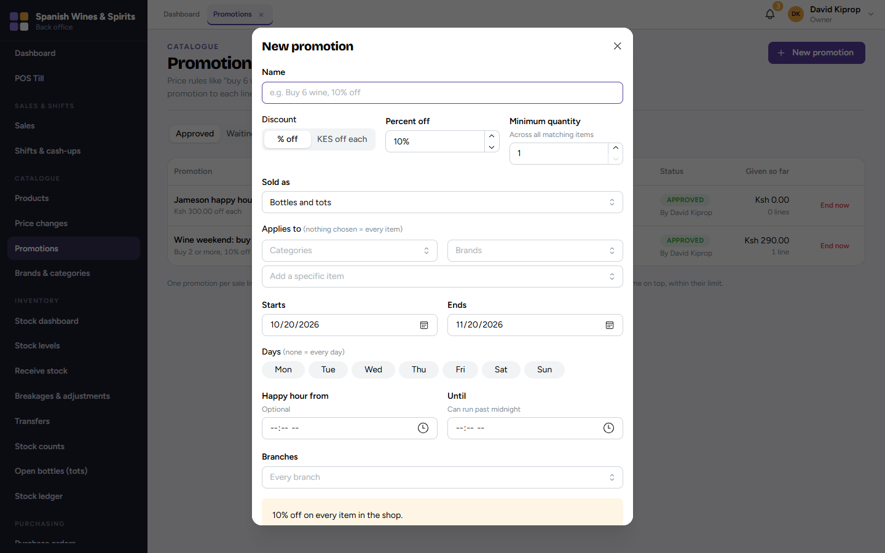
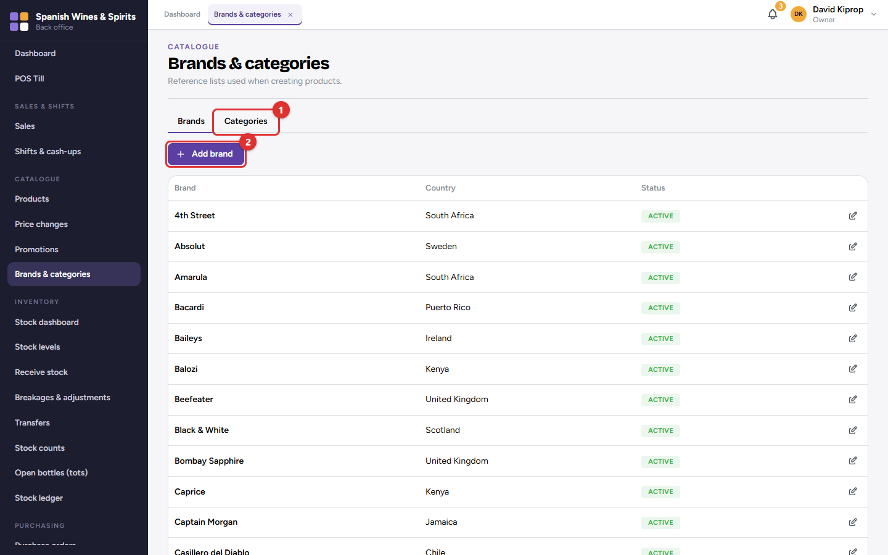

# 6. Products, prices and promotions

The **catalogue** is the list of everything the shop sells: each product, its sizes, barcodes and prices, and the promotions that take money off automatically at the till.

**Who:** the owner and admin manage the catalogue. Branch managers, storekeepers and the accountant can look. New prices and promotions are approved by the owner. **Where:** the **Catalogue** menu.

## Products and sizes

A **product** is a drink, such as *Johnnie Walker Black Label*. Each **size** of it (200 ml, 375 ml, 750 ml, 1 L) is a separate item with its own product code (**SKU**), barcode, price and stock. A **pack** (for example a crate of 24 beers) is a way of selling or receiving several of one size at once.

- **New product (1)** adds a product.
- Search by name, brand, SKU or barcode **(2)**, or filter by category and brand.
- Each row **(3)** shows the product, its category and its sizes. Click it for the details.

On a product:

- **Upload photo** adds a picture, shown on the till and stock screens. Use a clear photo of the bottle, square if possible.
- **Edit product** changes the name, brand, category or description.
- **Add size** adds another size.
- The **⋯** button on each size has: *Edit size*, *Add barcode*, *Add pack*, *Change price*, *Price history* and *Set reorder level*.

The **Tot** column shows the tot price for sizes that can be poured by the tot. The **Tax** column shows the VAT class used on the eTIMS invoice.

### Adding a product

1. Type the **Product name**, and choose the **Brand** and **Category**. The ABV % (alcohol strength) is optional.
2. For each size, enter the **Size (ml)**, the **Container** (bottle, can, box…), a short **SKU**, the **Tax** class, the **Barcode** (scan it) and the **Retail price**.
3. Click **Add size** for each extra size, then **Create product**.

> **Important:** Choose the tax class carefully. It decides the VAT on the eTIMS invoice. Ask your accountant if you are not sure. Most alcoholic drinks are standard-rated (16%).

> **Common mistake:** Typing a barcode by hand. Scan it from the bottle: one wrong digit means the till cannot find the item.

## Prices

Prices are set centrally for every branch, so all branches charge the same and tax invoices stay correct. Each size can have:

- a **retail** price (walk-in customers);
- a **wholesale** price (registered wholesale customers);
- a **tot** price, if it is sold by the tot.

To change a price, open the product, click **⋯** on the size, then **Change price**. Choose the price type, type the **New price**, the date it starts (**Effective from**, or leave empty for straight away) and a **Reason**.

A price change by anyone other than the owner waits for the owner's approval.

**Pending (1)** lists the changes waiting. The owner clicks **Approve** or **Reject**. *Approved* and *Rejected* keep the history. An approved price is never edited: a new change replaces it, so you can always see what was charged when.

> **Tip:** Branch managers cannot change prices. At the till they can still approve a discount on a sale, up to their limit.

## Promotions

A **promotion** takes money off automatically at the till when the sale qualifies. Nobody needs to remember it.

- **New promotion (1)** creates one.
- The list **(2)** shows each promotion, its status and how much discount it has given so far. **End now** stops one early.

1. Give it a **Name** the customer will understand, such as *Wine weekend: buy 2, 10% off*. It is printed on the receipt.
2. Choose **% off** or **KES off each**, and the amount.
3. **Minimum quantity:** how many matching items must be in the sale (across all matching items).
4. **Sold as:** bottles, tots, or both.
5. **Applies to:** categories, brands or particular items. Leave it empty for every item.
6. **Starts** and **Ends**; optionally the **Days** of the week and **Happy hour** times (which can run past midnight).
7. **Branches:** leave empty for every branch.
8. The yellow box at the bottom repeats the promotion in plain words. Check it, then save.

A new promotion waits for the owner's approval (*Waiting for approval*) and starts only when approved.

> **Important:** Only one promotion applies to each item in a sale: the best one for the customer. A manager's discount at the till can still be added on top, within their limit.

## Brands and categories

Use the **Brands** and **Categories (1)** tabs to keep the lists tidy. **Add brand (2)** (or *Add category*) adds one; the pencil button edits one. Categories are the chips across the top of the till (Wine, Whisky, Vodka…), so keep them short.
