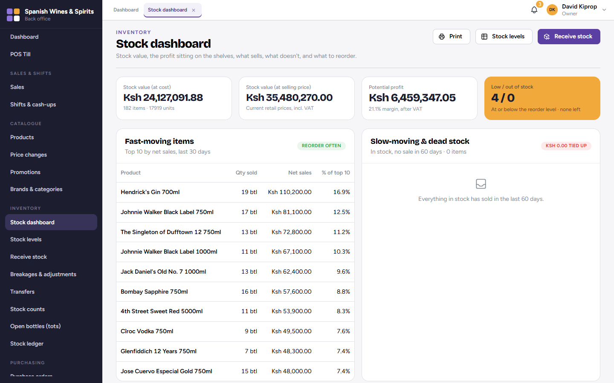
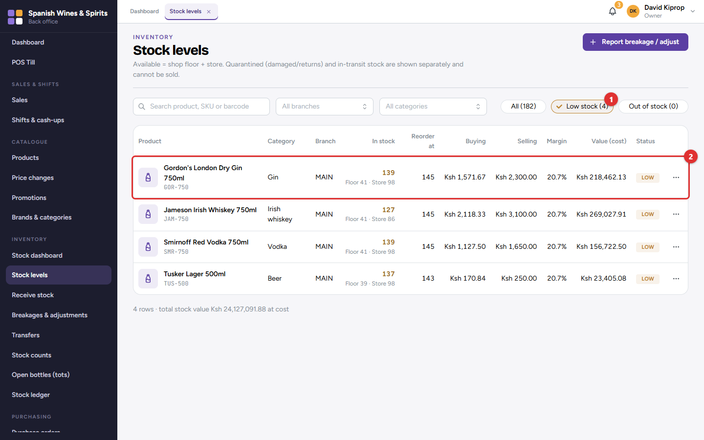
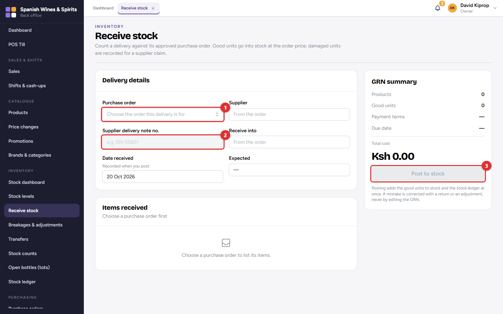
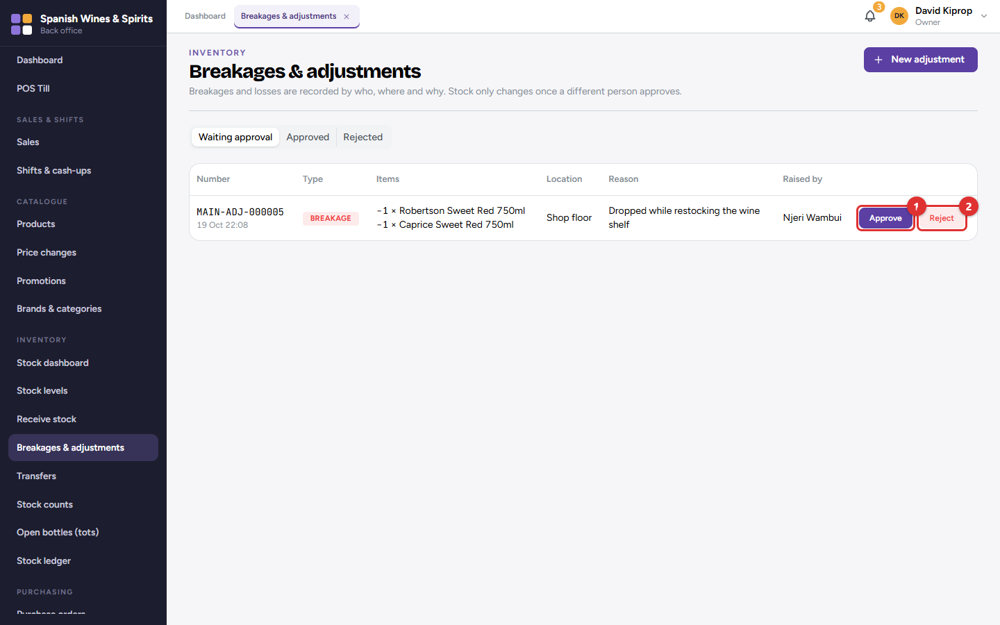
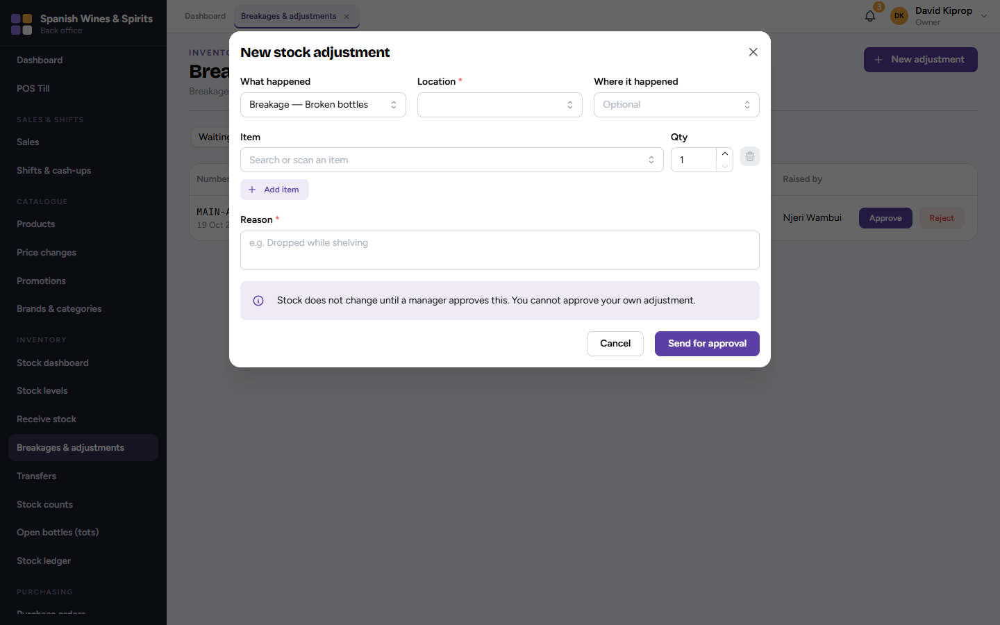
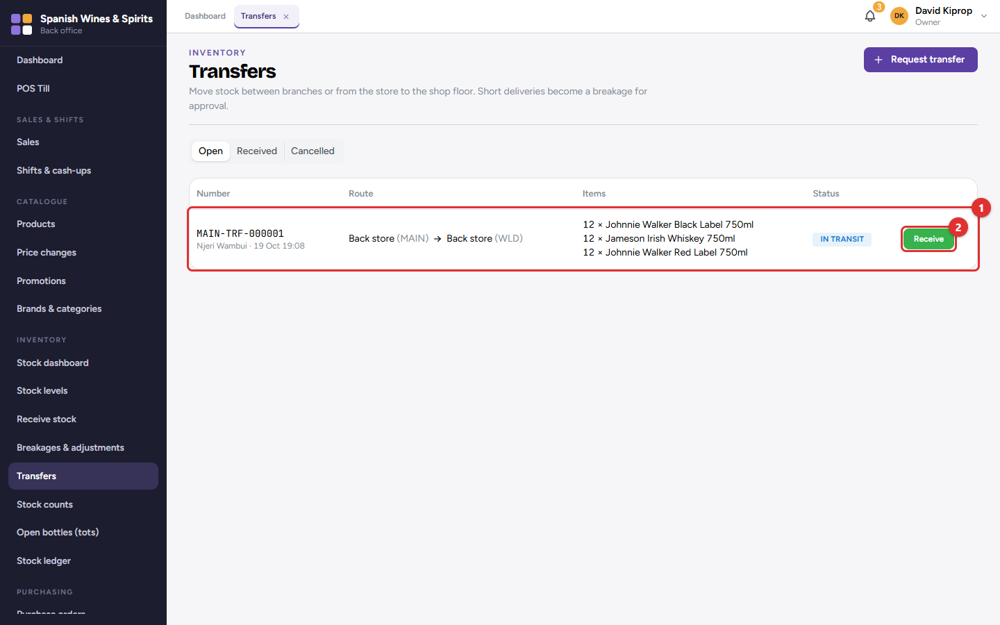
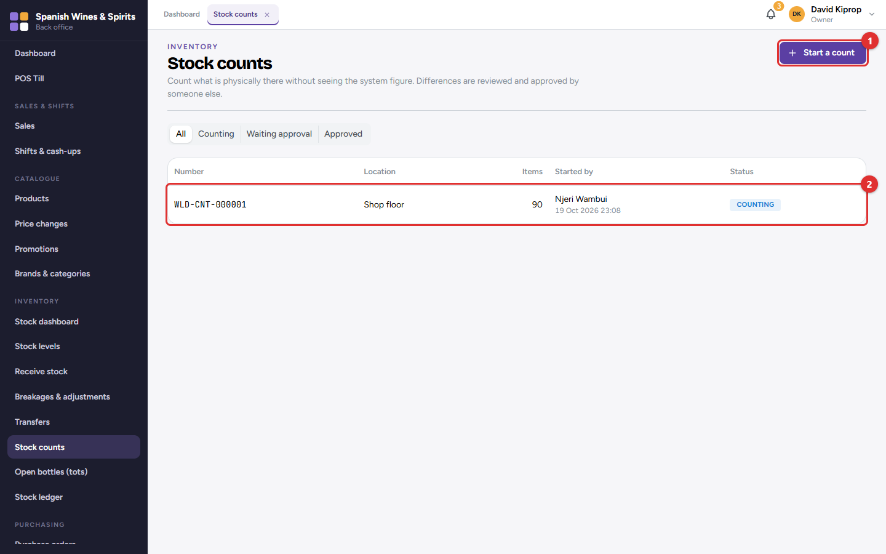
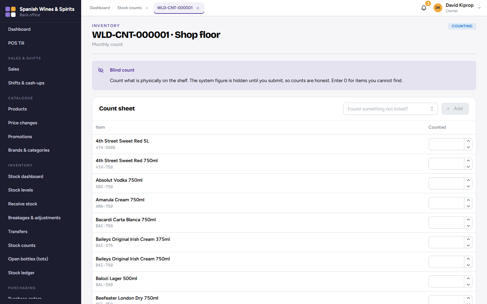
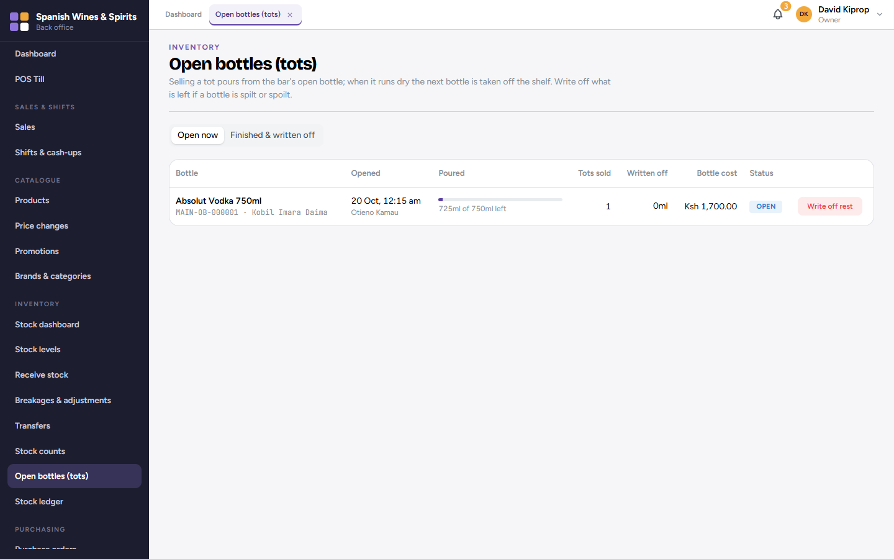
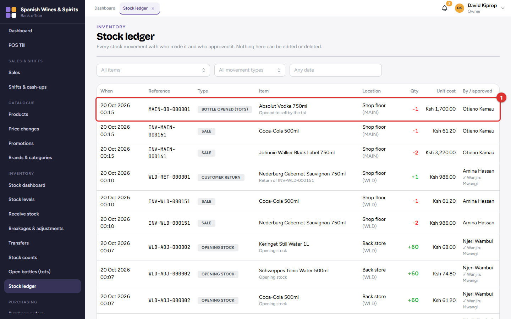

# 7. Stock

Tessera keeps track of every bottle at every branch. Stock is never typed in directly: it goes up when a delivery is received or a customer returns something, and down when something is sold, broken or moved. Each of those is a record in the **stock ledger**, so the stock figure can always be explained.

Each branch has three places for stock:

| Place | What is there |
| --- | --- |
| **Shop floor** | On the shelves, for sale. The till sells from here. |
| **Back store** | Stored stock, not yet on the shelves. |
| **Quarantine** | Damaged items, and opened or faulty returns, waiting for a manager. They cannot be sold. |

**Who:** storekeepers do most of the work; branch managers approve; the owner, admin and accountant can look at everything. **Where:** the **Inventory** menu.

## Stock dashboard

The stock dashboard shows, for the branches you can see:

- **Stock value at cost** and **at selling price**, and the **potential profit** between them;
- **Low / out of stock** (amber when something needs attention);
- **Fast-moving items** (order these often) and **slow-moving & dead stock** (money tied up on the shelf).

**Receive stock**, **Stock levels** and **Print** are at the top right.

## Stock levels

Search by product, SKU or barcode, or filter by branch and category. **Low stock (1)** and **Out of stock** show only the items that need ordering.

Each row **(2)** shows the stock in hand (split into shop floor and store), the **reorder level**, the buying and selling price, the margin, the stock value and a status badge: *In stock*, *Low* or *Out*.

The **⋯** button on a row sets that item's **reorder level**: when stock falls to this number, the item counts as low, and the owner and managers get an alert.

> **Tip:** Set reorder levels on your best sellers first. Start with about two weeks of sales and adjust over time.

## Receiving a delivery

Deliveries are received against an approved purchase order (chapter 8).

1. Choose the **Purchase order (1)** the delivery is for. The supplier, the branch and what is expected fill in by themselves.
2. Type the **Supplier delivery note no. (2)** from the driver's paperwork.
3. For each item, count what has arrived and enter the **good** quantity, and any **damaged** units separately.
4. Check the summary on the right, then click **Post to stock (3)**.

Good units go onto the stock straight away at the order's price. Damaged units are recorded for a claim against the supplier (*Returns to supplier*, chapter 8). The record of the delivery is the **GRN** (goods-received note).

> **Important:** Count before you post. A posted delivery cannot be edited: a mistake is corrected with a return to the supplier or a stock adjustment.

## Breakages and adjustments

Any stock lost or found outside a sale, delivery or transfer is an **adjustment**: breakage, theft, spoilage, expired goods, a correction after a count.

Adjustments waiting for a manager are listed first. The manager checks each one and clicks **Approve (1)** or **Reject (2)**.

1. Click **New adjustment** (or **Report breakage / adjust** on Stock levels).
2. Choose **What happened**, the **Location** (shop floor, store or quarantine) and, if you like, where it happened.
3. Add each **Item** and **Qty**.
4. Type the **Reason**, for example *Dropped while shelving*, and click **Send for approval**.

The stock does not change until a manager approves it, and nobody can approve their own adjustment.

## Transfers

A **transfer** moves stock between branches, or from the back store to the shop floor.

1. **Request transfer:** choose where from, where to, and the items. A manager approves it.
2. The sending branch **dispatches** it. It is now *In transit* **(1)**: it has left one branch but not reached the other.
3. The receiving branch clicks **Receive (2)** and enters what actually arrived.

If less arrives than was sent, the difference becomes a breakage for a manager to approve.

## Stock counts

A **stock count** (stock-take) checks what is really on the shelves against the system.

Click **Start a count (1)**, choose the branch and location, and whether it is a **blind count**. The count then appears in the list **(2)**.

1. Open the count and enter the number counted for each item. Enter 0 for an item you cannot find.
2. Found something not on the sheet? Add it with **Found something not listed?**.
3. Submit the count. With a blind count, the system's figure is shown only now, so the count is honest.
4. A manager reviews the differences and approves the count. The stock is then corrected, and the differences appear in the *Stock count variance* report.

> **Tip:** Count one area at a time (for example the whisky shelf) at a quiet hour, and keep selling from the other shelves.

## Open bottles (tots)

When the till sells a tot, it pours from the open bottle of that spirit. When the bottle runs dry, the next one is taken off the shelf. This screen shows each open bottle and how much is left. **Write off** what is left if a bottle is spilt or spoilt; *Finished & written off* keeps the history.

## Stock ledger

The ledger lists every movement of stock **(1)**: sales, returns, deliveries, returns to suppliers, adjustments, transfers, counts and tots. Filter by item, movement type and dates. Each line shows who did it, when, and the document it came from.

Nobody can edit or delete the ledger. Every night, Tessera also checks that the stock figures agree with the ledger, and tells the owner if anything does not match.
