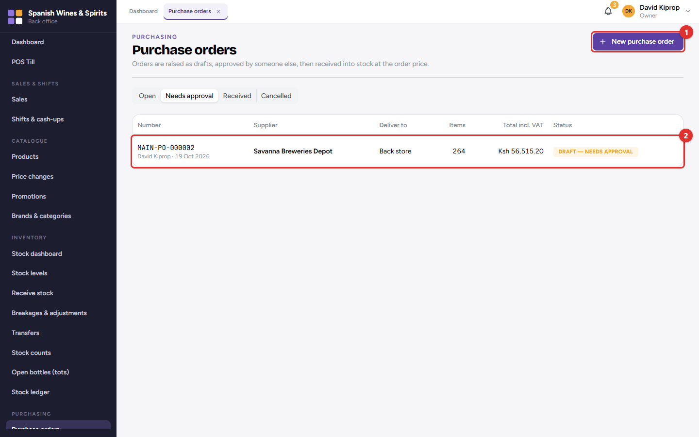
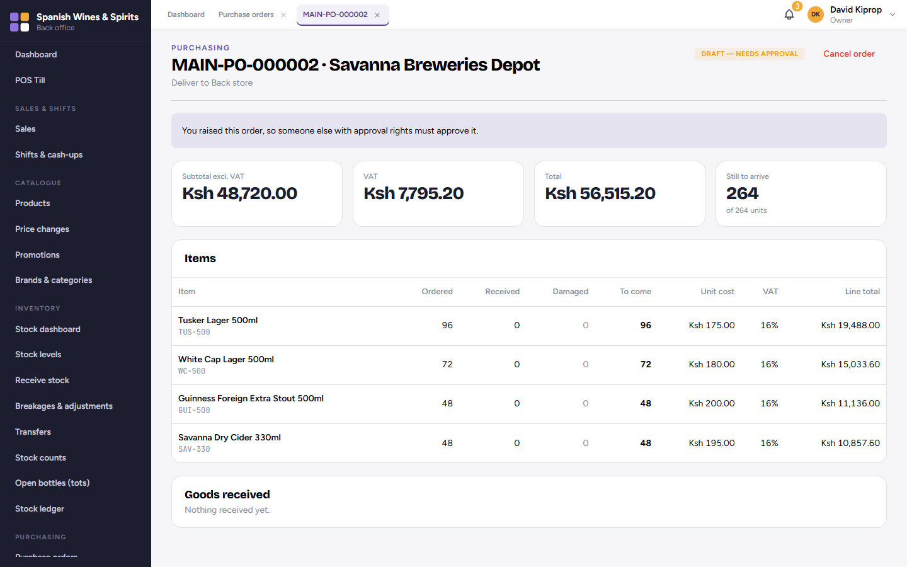
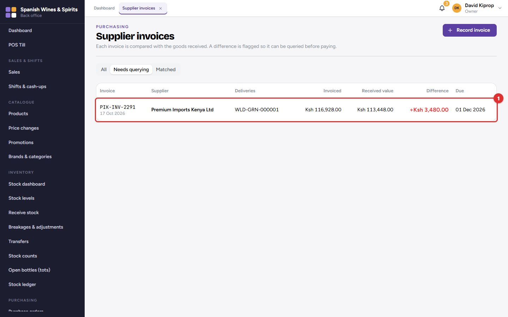
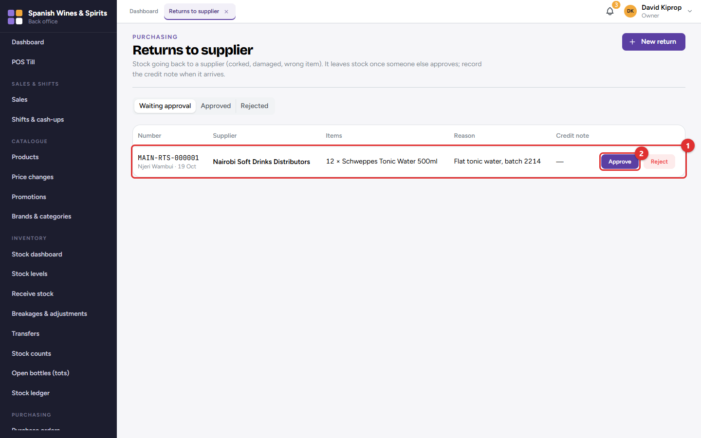
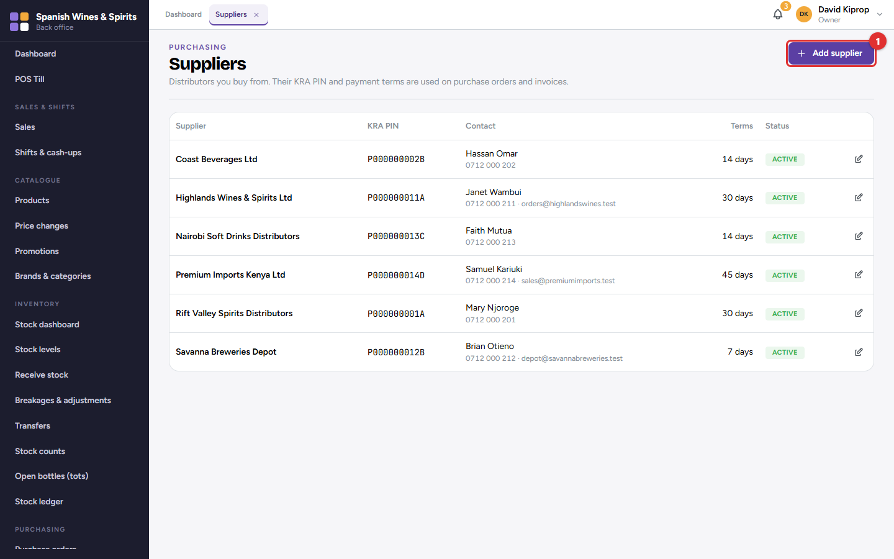
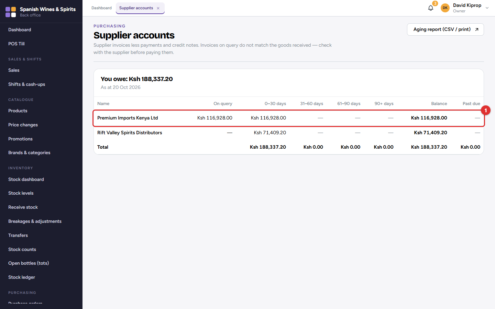
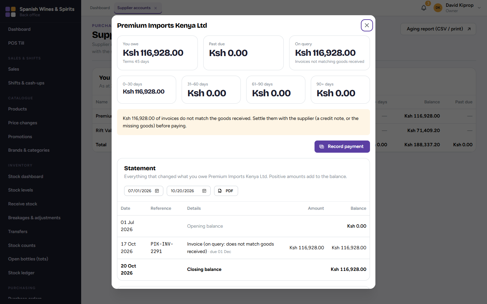

# 8. Purchasing and suppliers

Buying stock follows the same path every time:

1. A **purchase order** says what you are ordering from a supplier.
2. Someone else **approves** it, and it is sent to the supplier.
3. The delivery is **received** against the order (chapter 7), and the stock goes up.
4. The supplier's **invoice** is recorded and compared with what was received.
5. The supplier is **paid**.

Each step is done by the right person, and nobody approves their own order.

**Who:** the owner, admin or accountant raise orders; a branch manager, the owner or an admin approves them (never their own); storekeepers and managers receive; the owner, admin or accountant record invoices and payments. **Where:** the **Purchasing** menu.

## Purchase orders

The tabs show **Open** orders, those that **Need approval**, **Received** and **Cancelled** ones. Click **New purchase order (1)** to start one, or a row **(2)** to open it.

### Raising an order

1. Click **New purchase order**.
2. Choose the **Supplier** and the branch it is for.
3. Search or scan each item and enter the quantity and the unit cost. The VAT and total are worked out for you.
4. Click **Save draft**. The order now waits for approval.

Chapter 2 (Step 9) shows the new-order screen. The *Low stock & reorder suggestions* report (chapter 11) is a good starting list.

### Approving an order

The order shows the supplier, where it will be delivered, the subtotal, VAT and total, and each item with the quantity ordered, received, damaged and still to come.

The person approving checks the items and prices, then clicks **Approve** (or **Reject** with a reason). The person who raised it sees *You raised this order, so someone else with approval rights must approve it.* **Cancel order** stops an order that is no longer needed.

> **Common mistake:** Receiving goods that were not ordered. Only approved orders can be received. If the supplier brings extra, raise and approve an order for it first, or send it back.

## Supplier invoices

When the supplier's invoice arrives, record it so you know what you owe.

1. Click **Record invoice**, choose the supplier and the deliveries the invoice is for, and type the invoice number, date and amount.
2. Tessera compares the invoice with the value of the goods received. If they match, the invoice is **Matched**. If not, it goes to **Needs querying (1)** with the **Difference** in red.

Settle a difference with the supplier (a credit note, or the missing goods) before paying.

## Returns to supplier

Damaged, wrong or expired goods go back to the supplier with a **return**.

1. Click **New return**, choose the supplier and the items, and give a reason.
2. A manager approves it **(2)**. The stock leaves your books when it is approved.
3. Record the supplier's credit note when it comes; it reduces what you owe.

Returns waiting for approval are listed first **(1)**.

## Suppliers

Each supplier has a name, contact person, phone, email, KRA PIN and **payment terms** (for example 30 days). **Add supplier (1)** adds one; click a supplier to edit it. The terms decide when each invoice is due.

## Supplier accounts: what you owe

This screen lists what you owe each supplier **(1)**, split by age: current, 31–60, 61–90 and over 90 days, with what is past due. **Aging report (CSV / print)** gives the same list for the accountant.

Click a supplier to see:

- **You owe**, **Past due** and **On query** (invoices that do not match the goods received);
- the amounts by age;
- **Record payment** to record a payment you have made (bank, M-PESA or cash, with its reference);
- the **Statement**: every invoice, payment, credit note and return between two dates. Click **PDF** to download it, for example to agree balances with the supplier.

> **Important:** A payment is never edited or deleted. If one was recorded by mistake, reverse it; both lines stay on the statement.
