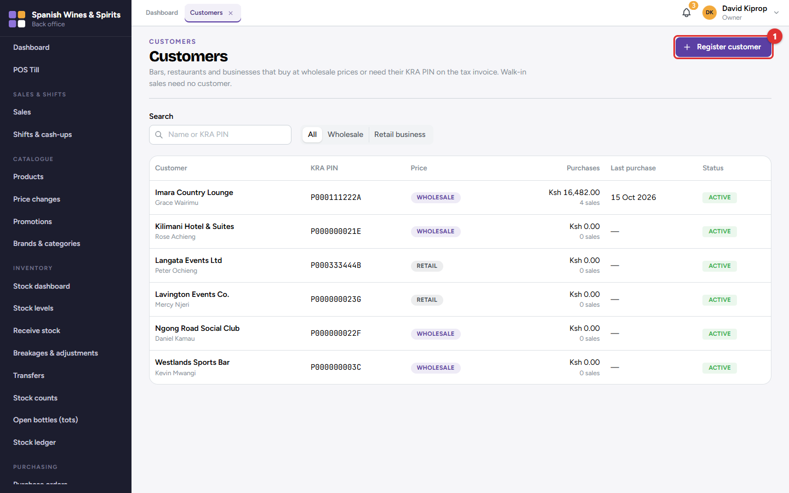
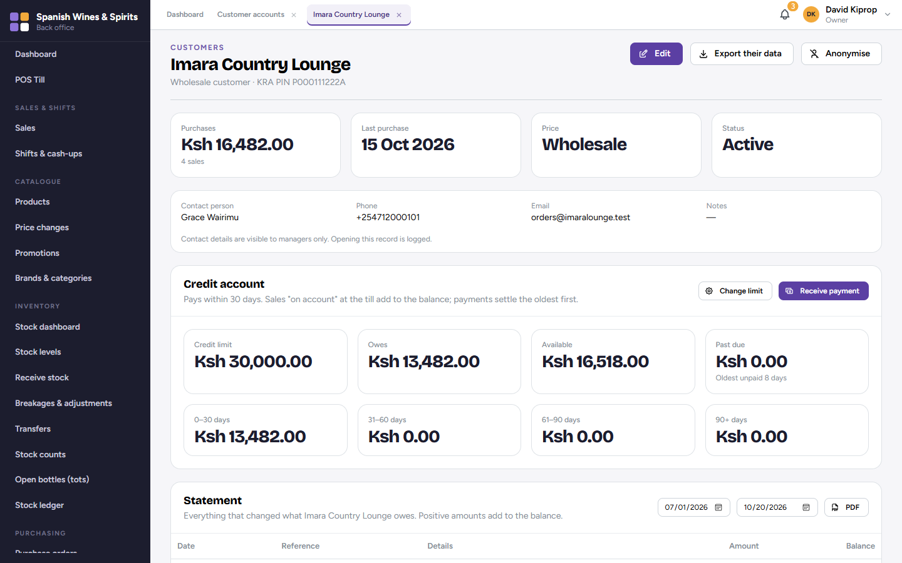
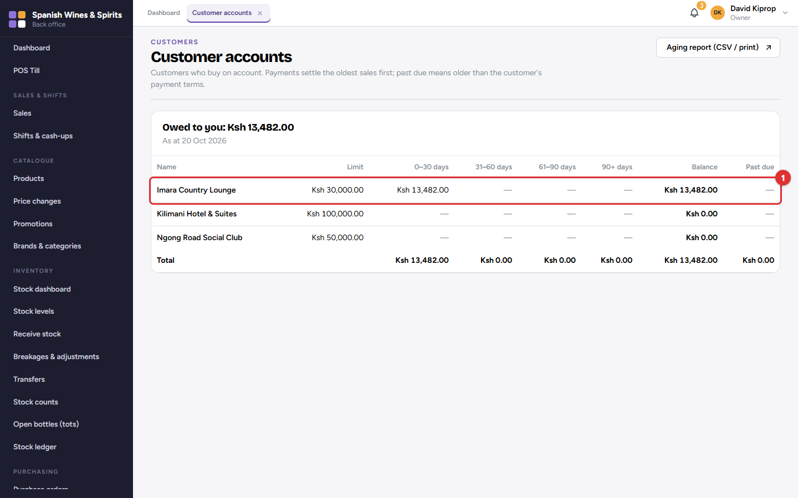

# 9. Customers and credit

Walk-in customers need no record. Register a customer when they are:

- a **wholesale** buyer, such as a bar, hotel or restaurant, who pays wholesale prices;
- a business that needs its **KRA PIN** on the tax invoice;
- a customer who buys **on account** (pays later).

**Who:** the owner, admin and branch managers register and edit customers; the owner, admin and accountant manage credit; cashiers can only find and choose a customer at the till. **Where:** **Customers → Customers** and **Customer accounts**.

## The customer list

Search by name or KRA PIN, or show only **Wholesale** or **Retail business** customers. Each row shows the customer, their KRA PIN, which prices they pay, their purchases and the date of their last purchase.

### Registering a customer

1. Click **Register customer (1)**.
2. Type the **Business name** and **KRA PIN**. The PIN is printed on their tax invoices.
3. Tick **Wholesale customer — pays wholesale prices at the till** if they buy at wholesale prices.
4. Add a contact person, phone, email and address, then save.

> **Important:** Customer contact details are personal data. Only managers can see them, and every time someone opens a customer's record it is logged. Collect only what you need.

## A customer's record and credit account

At the top: their purchases, last purchase, price level (retail or wholesale) and status. **Edit** changes their details.

Under **Credit account**:

| Figure | Meaning |
| --- | --- |
| **Credit limit** | The most they may owe at any time. |
| **Owes** | What they owe now. |
| **Available** | Limit − owes: how much more they can buy on account. The till checks this. |
| **Past due** | Unpaid past their payment terms, with the age of the oldest unpaid sale. |
| **0–30, 31–60, 61–90, 90+ days** | What they owe, by age. |

- **Change limit** sets the credit limit and the payment terms (for example 30 days), or switches buying on account on or off.
- **Receive payment** records money they have paid you: the amount, how it was paid and its reference. A payment settles the oldest sales first.
- The **Statement** lists every sale on account, payment and return between two dates. Click **PDF** to download it and send it to the customer.

> **Common mistake:** Giving credit without a limit. Set a limit for every account customer and check *Past due* each week.

### Other buttons

- **Export their data:** downloads everything held about the customer, if they ask for it (Data Protection Act).
- **Anonymise:** if the customer asks to be forgotten, removes their name and contact details while keeping the sales for the tax records. You must give a reason, and it cannot be undone. Only the owner or an admin can export or anonymise.

## Customer accounts: who owes you

All account customers in one list **(1)**: what each owes, split by age, and what is past due. Click a customer to open their account. **Aging report (CSV / print)** gives the list for the accountant.

## Selling on account at the till

1. At the till, tap **Walk-in customer** and choose the customer.
2. Tap **Complete sale**, then **On account**. The till shows how much credit is available.
3. The amount goes onto the customer's account; nothing is paid at the till.

A sale over the available credit is refused. Part of the sale can be paid now and the rest put on account with **Split**.
