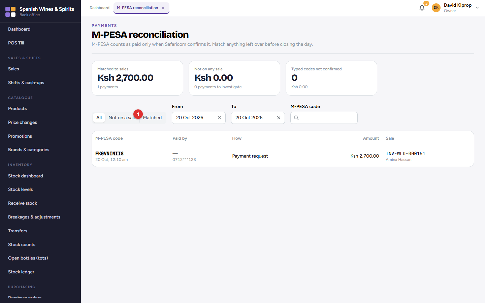
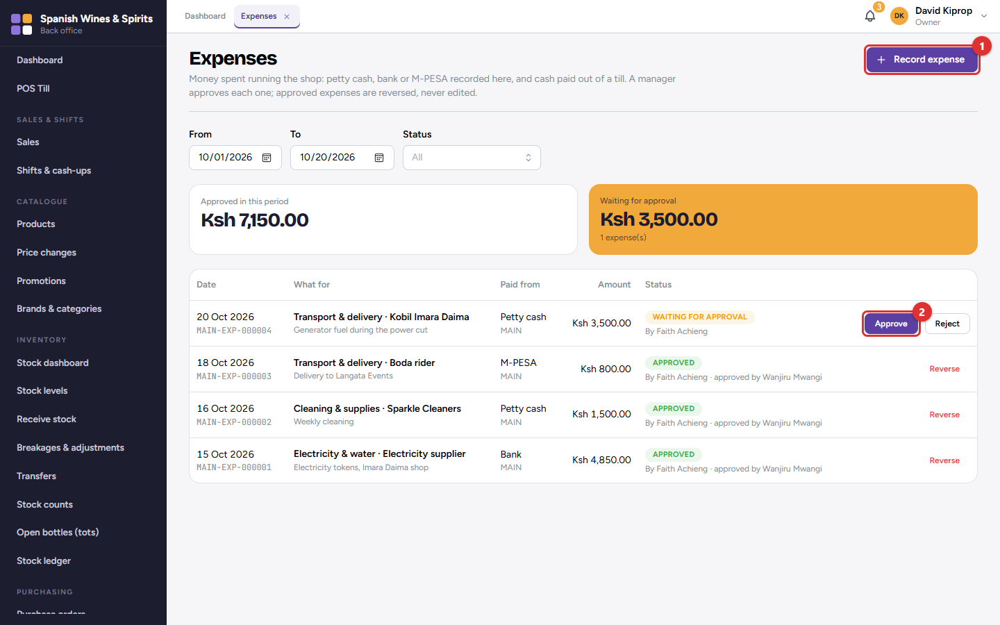
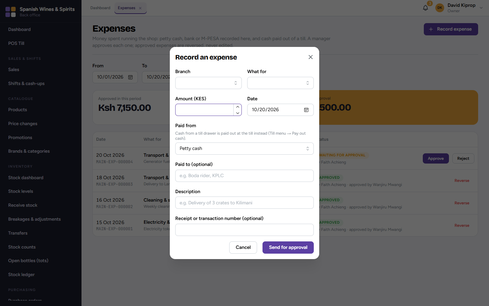
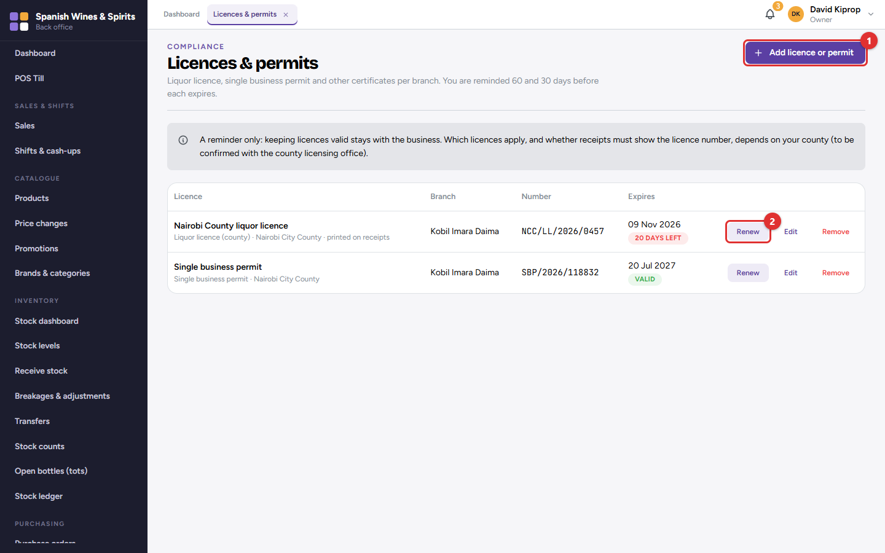
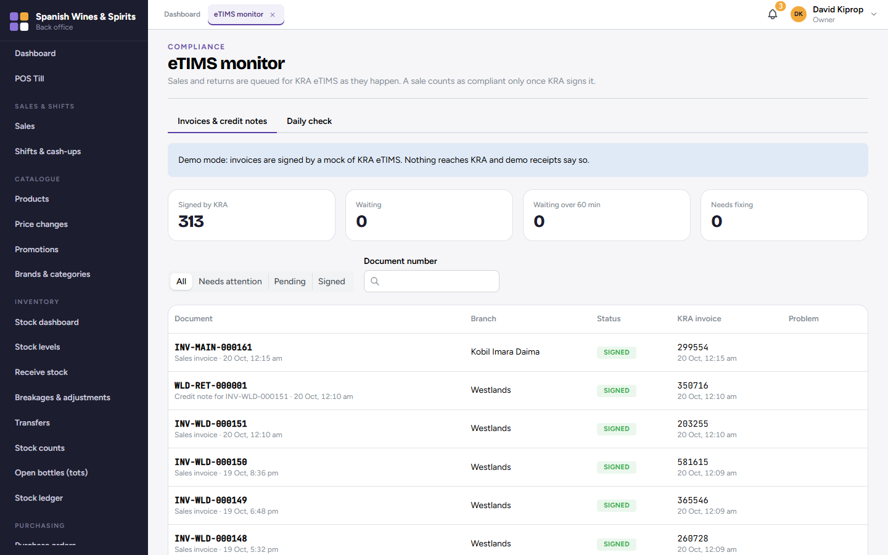

# 10. Money: M-PESA, expenses, licences and eTIMS

This chapter covers the screens that keep the money and the paperwork straight: checking every M-PESA payment, recording what the shop spends, keeping licences valid, and making sure every invoice reached KRA.

**Who:** the owner, admin, branch managers and the accountant. **Where:** **Payments**, **Expenses** and **Compliance**.

## M-PESA reconciliation

An M-PESA payment counts as paid only when Safaricom confirms it. This screen matches every M-PESA payment received with a sale, so nothing is missed or counted twice.

The boxes at the top show:

| Box | Meaning |
| --- | --- |
| **Matched to sales** | Payments that belong to a sale. All is well. |
| **Not on any sale** | Money received with no sale. Investigate each one. |
| **Typed codes not confirmed** | M-PESA codes typed at the till while it was offline that Safaricom has not confirmed. |

Choose **Not on a sale (1)** to see only the payments to investigate. Each row shows the M-PESA code, who paid, how (*Payment request* from the till, or *Paid to till*), the amount and the sale. Search by **M-PESA code** to find one payment.

A payment with no sale usually means a customer paid to the till number but the cashier did not choose the payment at the till. Find the sale and match it, or refund the customer.

> **Tip:** Check *Not on a sale* before closing each day. It should be empty.

> **Important:** While the system runs on its demonstration connection, payments come from a practice copy of M-PESA and no real money moves. The screens say so. The live connection is switched on when your business goes live.

## Expenses

Every shilling spent running the shop is an **expense**: rent, electricity, transport, cleaning, generator fuel. Recording them gives the true profit and keeps the petty cash honest.

The screen shows the total approved in the period and what is waiting for approval. A manager checks each new expense and clicks **Approve (2)** or **Reject**. Nobody approves their own expense.

1. Click **Record expense (1)**.
2. Choose the **Branch** and **What for** (the expense category).
3. Type the **Amount** and the **Date**.
4. Choose where the money came from (**Paid from**: petty cash, bank or M-PESA). Cash taken from a till drawer is recorded at the till instead (*Pay out cash*, chapter 4).
5. Add who was paid, a description and the receipt or transaction number.
6. Click **Send for approval**.

An approved expense is never edited. If it was wrong, click **Reverse** and record it again correctly.

## Licences and permits

Keep your liquor licence, single business permit and other certificates here, for each branch. Tessera reminds the owner and managers 60 and 30 days before each one expires.

- **Add licence or permit (1):** the type, the issuing county, the branch, the number and the expiry date. Tick **Print this number on receipts** for a licence that must appear on receipts.
- **Renew (2):** enter the new number and expiry date when you have renewed it.
- **Edit** corrects a mistake; **Remove** takes off one you no longer hold.

The badge shows how many days are left, in red when it is close.

> **Important:** Tessera only reminds you. Keeping licences valid stays with the business, and which licences apply depends on your county.

## eTIMS monitor

Every sale and every return is sent to KRA's eTIMS automatically, straight after it is made. This screen shows that each one was signed.

The boxes at the top count invoices **Signed by KRA**, **Waiting**, **Waiting over 60 min** and **Needs fixing**. The list shows each document (sales invoices and credit notes for returns), its branch, its status and KRA's invoice number.

- **Needs attention** shows only the invoices with a problem, and what the problem is.
- **Daily check** compares each day's sales with what KRA has signed.

A short wait is normal. If invoices stay *Waiting* for over an hour, or any *Need fixing*, contact Tessera support.

> **Important:** While the system runs on its demonstration connection, invoices are signed by a practice copy of eTIMS and nothing reaches KRA. The screen says so at the top. The live connection is switched on when your business goes live.
