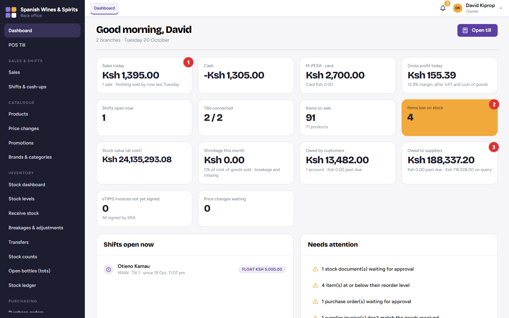
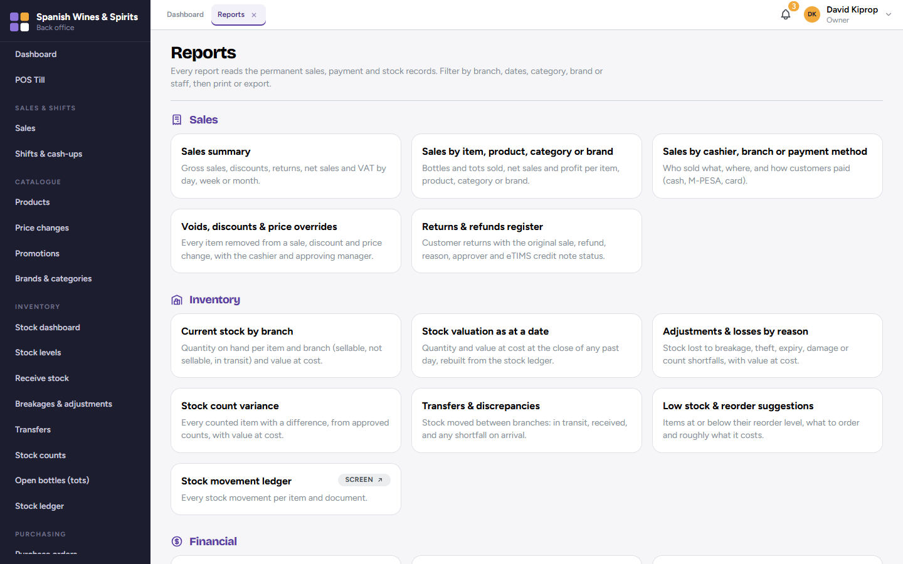
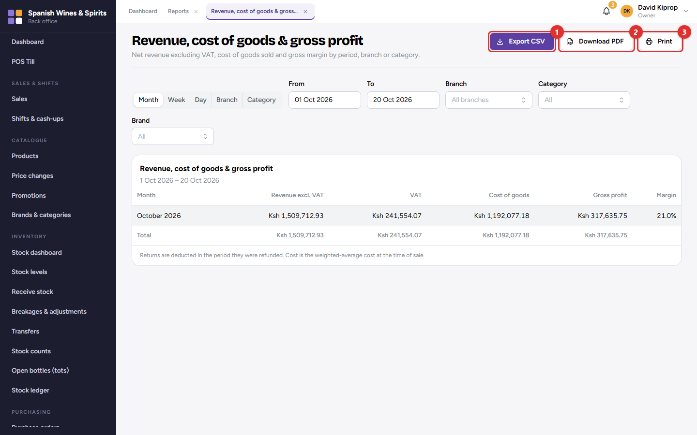
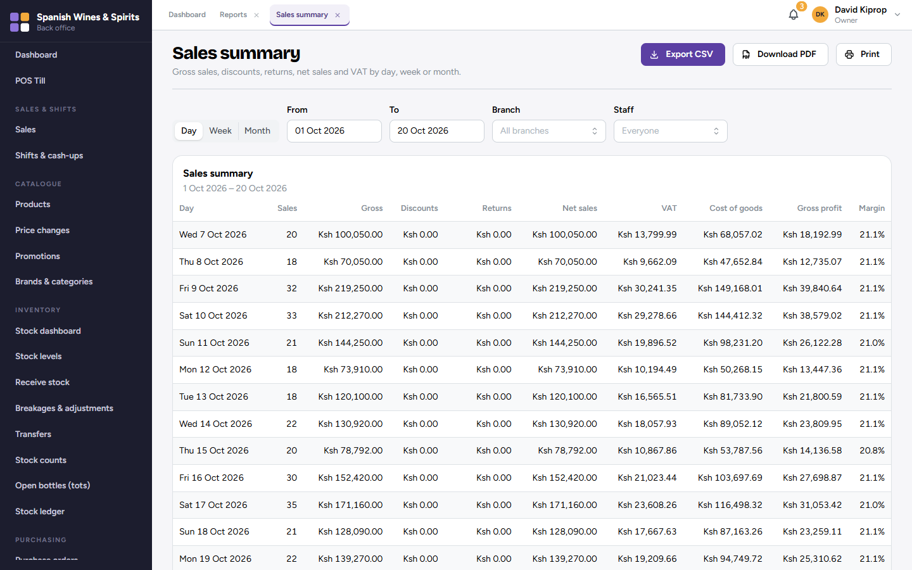

# 11. Dashboard and reports

The **dashboard** shows how the business is doing today, at a glance. The **reports** give the detail behind every figure, for any period, ready for Excel, PDF or paper.

**Who:** the owner, admin, branch managers and the accountant (reports with profit or money owed need the financial permission). Storekeepers have a stock-only dashboard. **Where:** **Dashboard** and **Reports**.

## The dashboard

The tiles at the top show the figures for the branches you can see, for example:

- **Sales today (1)**, split into cash and M-PESA · card, and the **gross profit today**;
- **Items low on stock (2)** and the **stock value (at cost)**;
- **Owed to suppliers (3)** and **owed by customers**;
- **Shifts open now**, **tills connected**, **price changes waiting**, **eTIMS invoices not yet signed** and **shrinkage this month** (stock lost).

A tile turns **amber** when something needs your attention.

Below the tiles: **Needs attention**, **Shifts open now**, **Low stock — reorder first**, **Best sellers and slow movers**, **Branches this month**, **Cash variance by cashier** and **Discounts, voids and refunds today**. What you see depends on your role: a branch manager sees only their branches, and a storekeeper sees only stock.

> **Tip:** Make the dashboard your first stop every morning, and the notifications bell your second.

## Reports

The reports are grouped by **Sales**, **Inventory**, **Financial** and **Compliance**. Click one to open it. Reports marked *Screen* open the screen where the same information already lives (for example the stock ledger or the audit log).

| Group | Reports |
| --- | --- |
| **Sales** | Sales summary · Sales by item, product, category or brand · Sales by cashier, branch or payment method · Voids, discounts & price overrides · Returns & refunds register |
| **Inventory** | Current stock by branch · Stock valuation as at a date · Adjustments & losses by reason · Stock count variance · Transfers & discrepancies · Low stock & reorder suggestions · Stock movement ledger |
| **Financial** | Revenue, cost of goods & gross profit · Shift cash-up & variance · Purchases by supplier · Receivables aging · Payables aging · Expenses (petty cash) · M-PESA reconciliation |
| **Compliance** | eTIMS status, failures & daily check · Licence & permit expiry list · Audit trail |

### Using a report

1. Choose how to group the figures (for example by **Month**, **Week**, **Day**, **Branch** or **Category**).
2. Set the **From** and **To** dates and any filters (branch, category, brand…). The report updates as you go.
3. Take it away:
   - **Export CSV (1)** opens in Excel or Google Sheets;
   - **Download PDF (2)** gives a branded A4 document, for example for the accountant or the bank;
   - **Print (3)** prints it.

Each report says how its figures are worked out at the bottom. For example, profit uses the average cost of the goods at the time of the sale, and returns are taken off in the period they were refunded.

## Which report for which question?

| Question | Report |
| --- | --- |
| How much did we sell, and how much VAT is in it? | Sales summary |
| What sells best? What doesn't? | Sales by item, product, category or brand |
| Who gave discounts, voided items or changed prices? | Voids, discounts & price overrides |
| What is our stock worth? | Stock valuation as at a date |
| What did we lose to breakages and theft? | Adjustments & losses by reason |
| What should we order? | Low stock & reorder suggestions |
| Are we making money? | Revenue, cost of goods & gross profit |
| Which cashiers are short? | Shift cash-up & variance |
| Who owes us, and whom do we owe? | Receivables aging, Payables aging |
| Has every invoice reached KRA? | eTIMS status, failures & daily check |

## Month end

At the end of each month, send the accountant:

1. **Sales summary** for the month, grouped by day (gross sales, discounts, returns, net sales and VAT);
2. **Revenue, cost of goods & gross profit**;
3. **Expenses (petty cash)**;
4. **Receivables aging** and **Payables aging** as at the last day of the month;
5. **Stock valuation** as at the last day of the month.

Because every sale was signed on eTIMS as it happened, the VAT figures match what KRA has on record.
