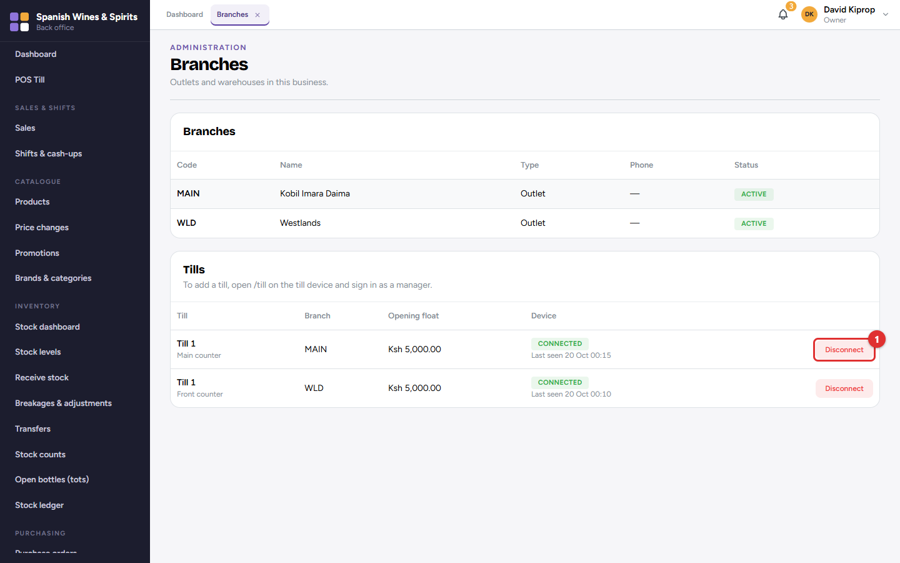
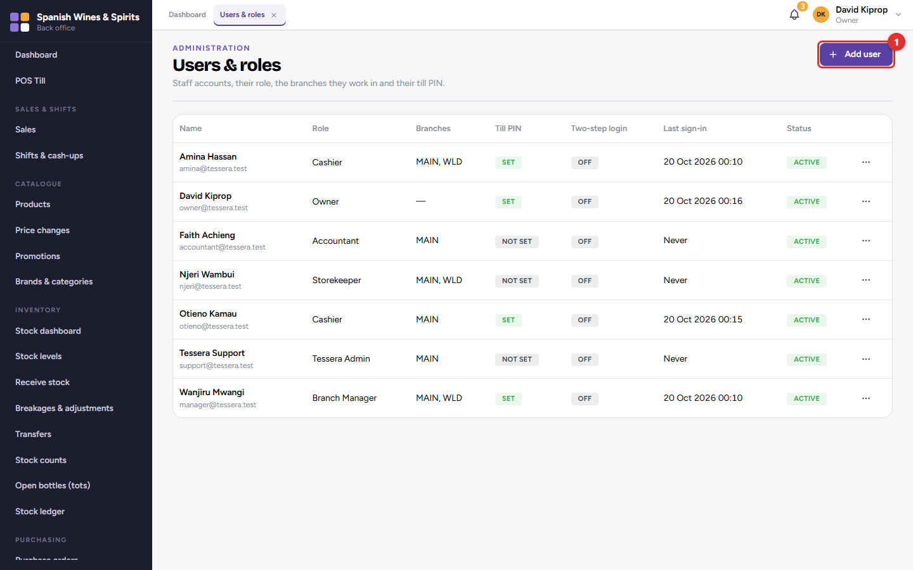
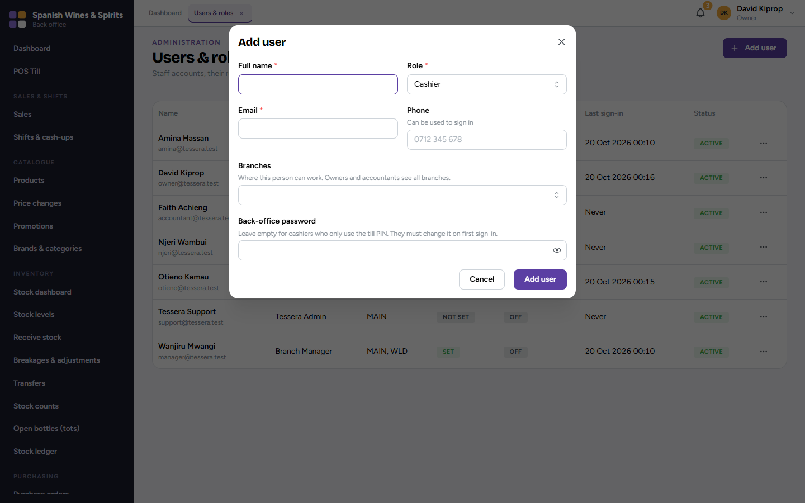
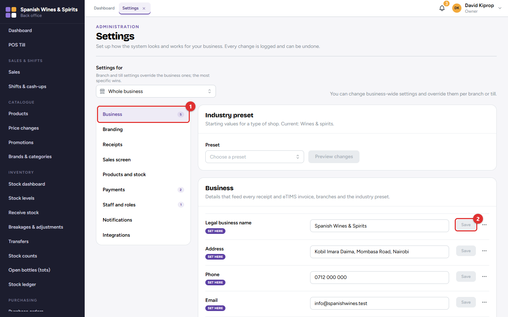
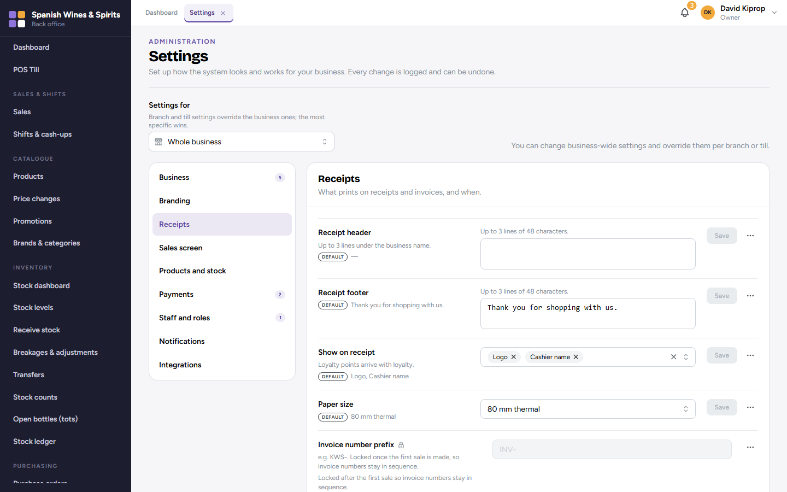
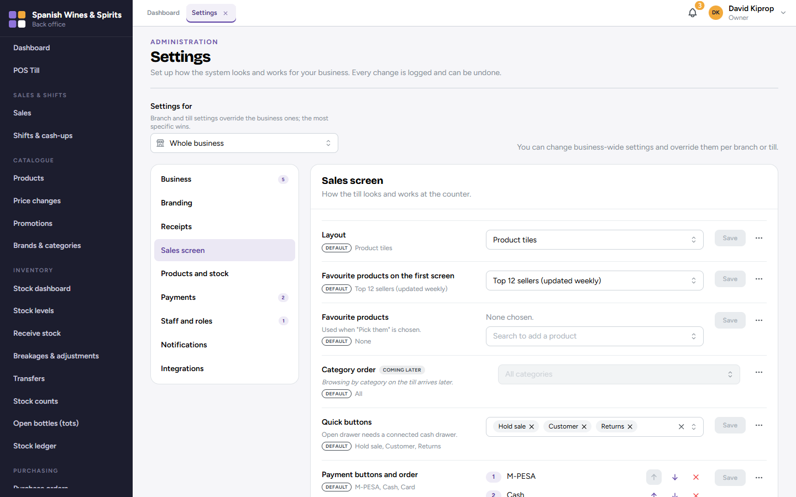
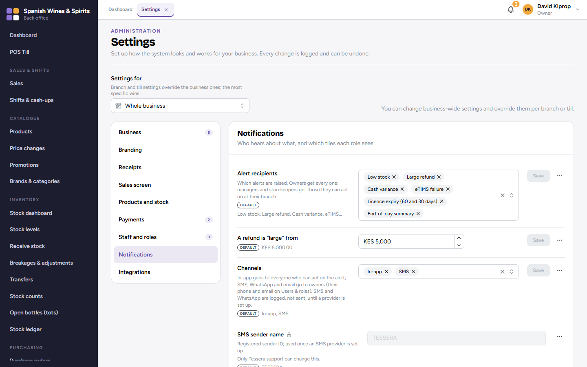
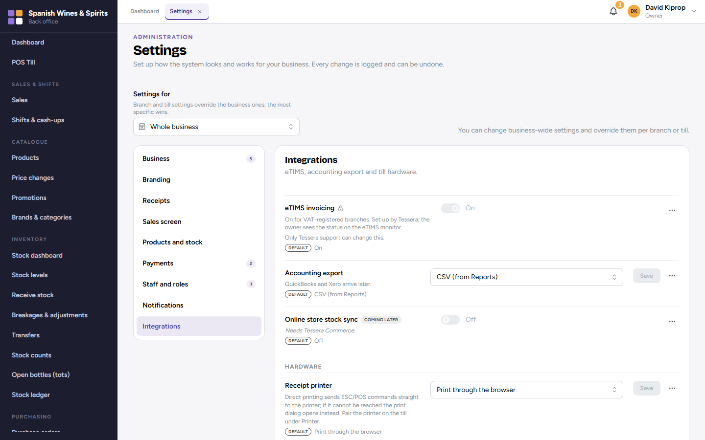
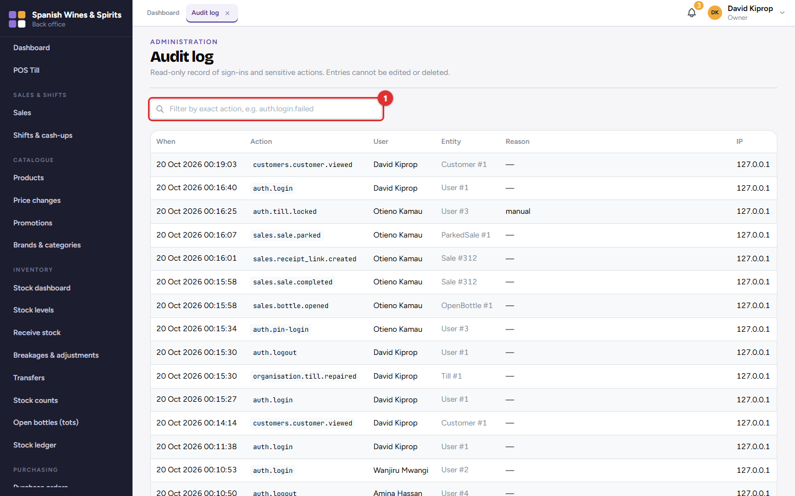

# 12. Administration

Administration covers the branches and tills, the staff and what each may do, the settings that decide how the system works, and the audit log.

**Who:** the owner and admin. Branch managers can change some settings for their own branch. **Where:** the **Administration** menu.

## Branches and tills

**Branches** lists each shop (or warehouse) with its code, name and status. The code is part of every document number, for example *INV-**MAIN**-000161*.

**Tills** lists every till, its branch, its opening float and whether its computer is connected (*Last seen* tells you when it was last used).

- To **add a till**, set it up from the till computer itself (chapter 3).
- To **stop a computer from selling** (lost, stolen or replaced), click **Disconnect (1)**. Setting up a new computer with the same till name also disconnects the old one.

## Users and roles

Every person gets their own account. The list shows each person's role, branches, whether they have a till PIN and two-step login, when they last signed in, and whether the account is active.

### Adding a user

1. Click **Add user (1)**.
2. Type the **Full name** and choose the **Role** (chapter 1 explains each role).
3. Type their **Email**, and optionally their **Phone**, which they can also use to sign in.
4. Choose the **Branches** where they work. Owners and accountants see all branches.
5. For anyone who uses the back office, type a first **Back-office password**. They must change it the first time they sign in. Leave it empty for cashiers who only use the till.
6. Click **Add user**.

The **⋯** button on each person has:

- **Edit:** change the name, role, branches, or untick **Account active** when someone leaves. Their history is kept.
- **Set till PIN** / **Change till PIN:** a four-digit PIN for signing in at the till. Type it twice.
- **Reset two-step login:** if someone has lost their phone.

> **Important:** When someone leaves, make the account inactive the same day. Never share an account.

> **Tip:** To reset a forgotten password, click **Edit** and type a new one. The person must change it when they next sign in.

## Settings

Settings are grouped in sections on the left: **Business (1)**, Branding, Receipts, Sales screen, Products and stock, Payments, Staff and roles, Notifications and Integrations. A number next to a section shows how many settings are set at this level.

To change a setting, edit it and click its **Save (2)** button. Every change is logged and can be undone: the **⋯** button next to a setting shows its history.

**Settings for** (at the top) chooses where the setting applies: the whole business, one branch, or one till. A branch or till setting overrides the business one; the most specific wins. Each setting shows a badge: *Default*, *Set here*, or where its value comes from.

Some settings show a lock: they are set up by Tessera support (for example eTIMS), or locked after the first sale so numbers stay in sequence (for example the invoice number prefix). Settings marked *Coming later* cannot be used yet.

The **Industry preset** fills in sensible starting values for a type of shop (here *Wines & spirits*). Click **Preview changes** to see what it would change before applying it.

### The main sections

| Section | What you set there |
| --- | --- |
| **Business** | Legal name, address, phone, email, KRA PIN, VAT registration, financial year, currency. Printed on receipts and invoices. |
| **Branding** | The shop name shown in the system, logo, colours, and the sign-in page's picture and welcome text. |
| **Receipts** | Header and footer lines, what is shown (logo, cashier's name…), paper size, when to print, the invoice number prefix. |
| **Sales screen** | How the till looks and works: product tiles, favourites on the first screen, quick buttons, payment buttons and their order, the age check, licensed hours. |
| **Products and stock** | Selling by the tot, the licensed-hours lock, the default low-stock level, whether stock may go below zero. |
| **Payments** | Which payment methods are accepted, cash rounding, sales on account, the M-PESA till or paybill number. |
| **Staff and roles** | Discount limits, which actions need a manager's PIN, opening float and cash-up rules, password rules, idle sign-out and till lock, two-step login. |
| **Notifications** | Which alerts are raised, what counts as a "large" refund, the time of the end-of-day summary, which dashboard tiles each role sees. |
| **Integrations** | eTIMS (set up by Tessera), accounting export, the receipt printer, cash drawer and scanner. |

Alerts appear under the notifications bell for everyone who can act on them: owners get every alert; managers and storekeepers get the ones for their branch.

### Receipt printer and cash drawer

Under **Integrations → Receipt printer**, choose how the tills print:

- **Print through the browser:** works with any printer the computer knows; the print window opens for each receipt.
- **Direct printing** to a receipt printer connected by USB or a serial cable: faster, and it can open the **cash drawer** when a cash sale is completed. Connect the printer once on each till (till menu → *Printer*). If the printer cannot be reached, the print window opens instead.

Set this for the whole business, or per till under **Settings for**.

> **Common mistake:** Changing a setting for the whole business when you meant one branch. Check **Settings for** before you save.

## Audit log

The audit log records who did what, and when: sign-ins (including failed ones), sales, refunds, approvals, price changes, settings changes, stock movements, payments and more. Filter by user, date or action **(1)**. Nobody can edit or delete it.

Use it to answer questions such as *who changed this price?* or *who approved this refund?*.
