# Settings: demo briefing

A short walk through **Administration → Settings** for Epic Lounge Wines & Spirits: what to show on each screen, what to say, and one thing to try live. Allow about ten minutes. Sign in as the owner.

The message to get across: **the owner decides how the shop works, from one screen, and nothing changes without a record.**

## 1. One screen for the whole shop

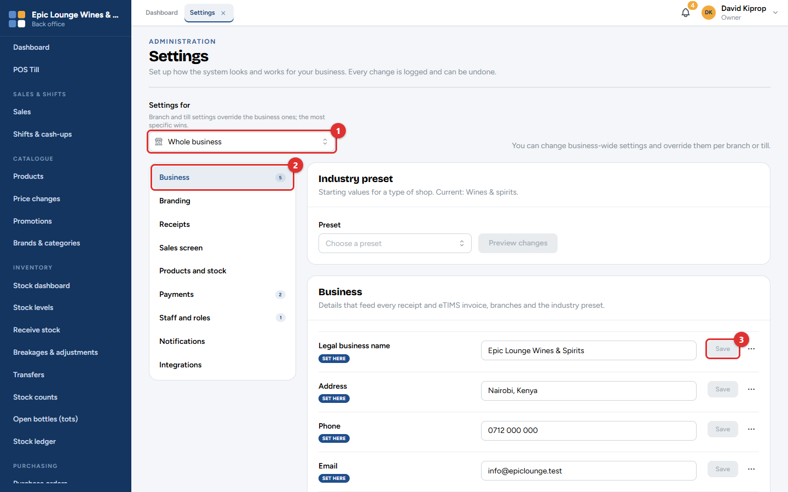

**Show**

- **Settings for (1)**: who the settings apply to.
- The sections on the left **(2)**: Business, Branding, Receipts, Sales screen, Products and stock, Payments, Staff and roles, Notifications, Integrations.
- Each setting has its own **Save (3)** button. Nothing changes until it is saved.

**Say:** "Every rule the shop runs on is here, in plain words. Each setting says what it does, and the badge shows whether it is the default or something you chose."

## 2. The whole shop, or just one till

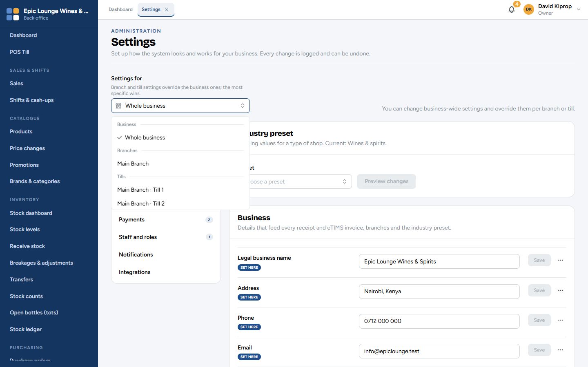

**Show:** open **Settings for**. Settings can apply to the **whole business**, to a **branch**, or to **one till**. The most specific one wins.

**Say:** "If the bar counter should take M-PESA only, set that on Till 2 alone. Everything else keeps the shop's settings."

## 3. Every change is logged and can be undone

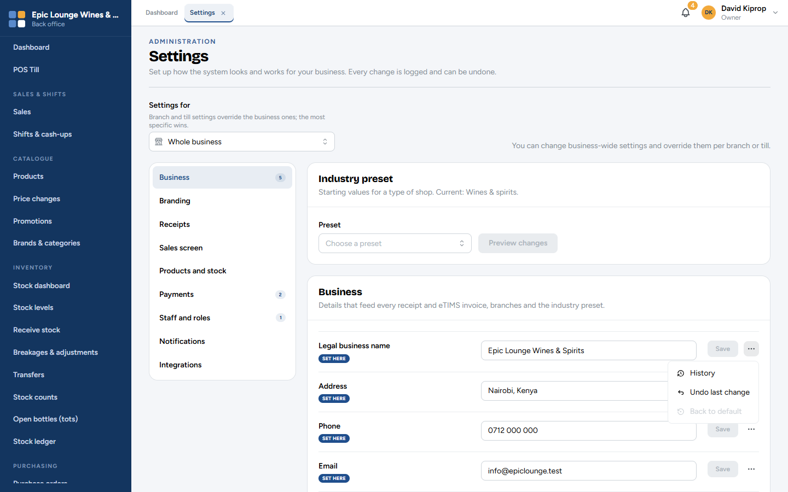

**Show:** click **⋯** next to any setting. It shows **History** (who changed it, when, from what), **Undo last change** and **Back to default**.

**Say:** "Nobody can quietly change a rule. You can always see who changed it and put it back."

## 4. Business and Branding: your name, your look

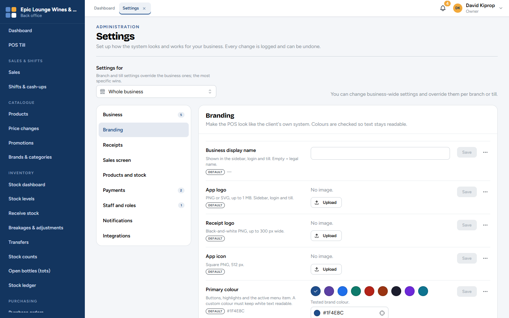

**Show**

- **Business:** the legal name, address, phone, email and KRA PIN. These print on every receipt and eTIMS invoice.
- **Branding:** the display name, the app logo, the receipt logo and the colours. Colours are checked so text stays readable.

**Try live:** change the **Primary colour** and save. The menu and buttons change at once. Then use **⋯ → Undo last change** to put it back.

## 5. Receipts

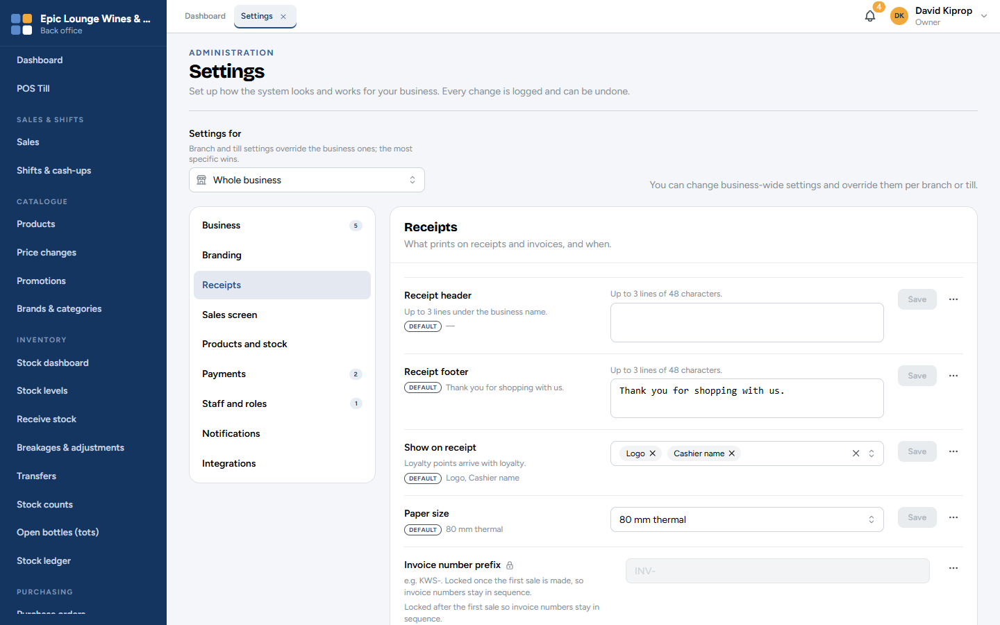

**Show:** the receipt header and footer (for example *"Thank you for shopping with us."*), what is printed on the receipt (logo, cashier's name), and the paper size (80 mm thermal).

**Point out:** the **invoice number prefix** is locked after the first sale, so invoice numbers always stay in sequence for KRA.

## 6. Sales screen: how the till works

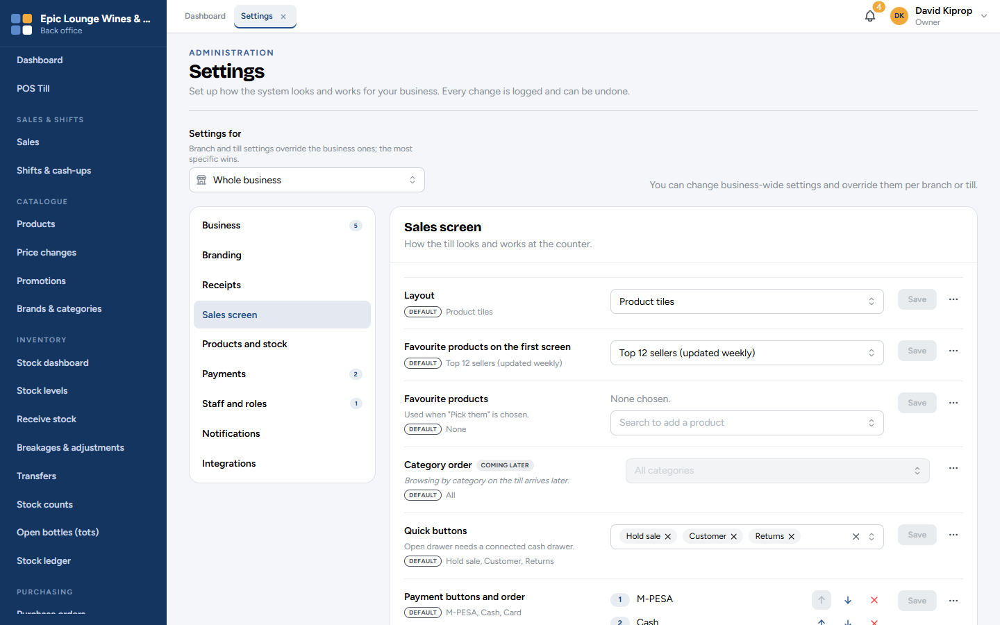

**Show**

- **Layout:** product tiles, or a list.
- **Favourites on the first screen:** the top 12 sellers (updated every week), or products you pick yourself.
- **Quick buttons:** Hold sale, Customer, Returns.
- **Payment buttons and their order:** M-PESA first, then Cash, then Card.

**Say:** "The cashier sees what sells most, one tap away. You decide which buttons they get."

## 7. Products and stock

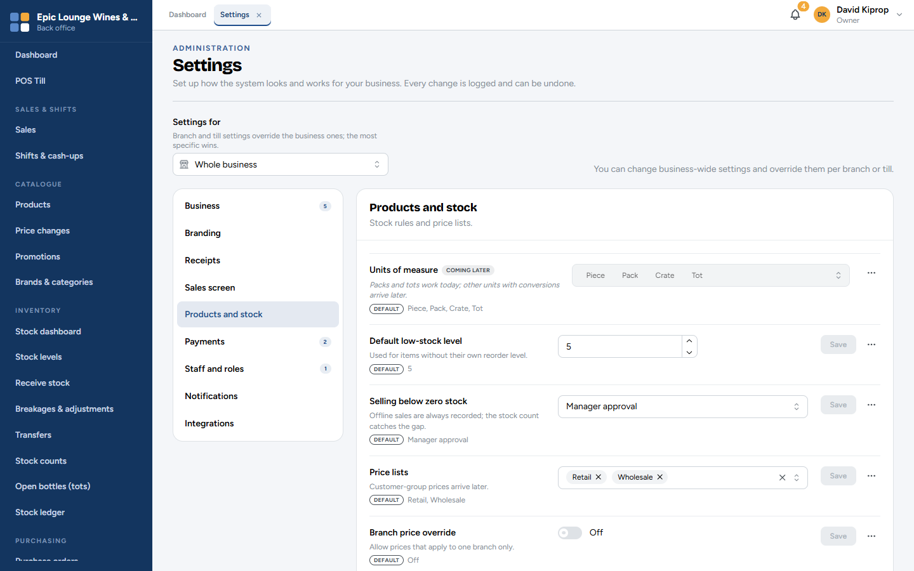

**Show**

- **Default low-stock level:** the stock level at which an item counts as running low, unless the item has its own reorder level.
- **Selling below zero stock:** here set to *Manager approval*.
- **Price lists:** Retail and Wholesale.

**Say:** "If the system says there's no stock and a bottle is on the shelf, a manager must approve the sale. The stock count then shows the gap."

## 8. Payments

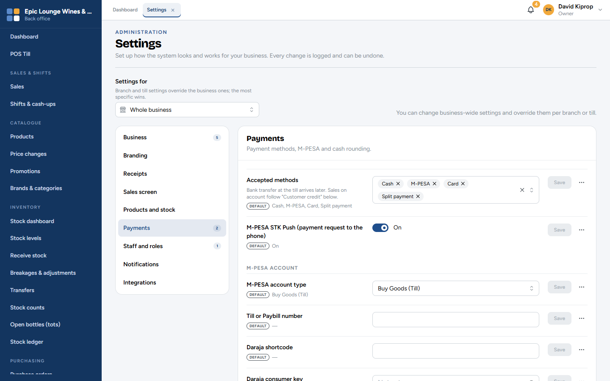

**Show**

- **Accepted methods:** Cash, M-PESA, Card and split payment.
- **M-PESA STK Push:** the customer gets a payment request on their phone.
- **The M-PESA account:** Buy Goods (Till) or Paybill, and its number.

**Say:** "We connect your own Till or Paybill number. The cashier only sees *M-PESA*, and the payment is confirmed by Safaricom before the sale completes."

> **Important:** the demo runs on a practice M-PESA connection, so no money moves. Your Safaricom details are entered when the shop goes live.

## 9. Staff and roles: limits and control

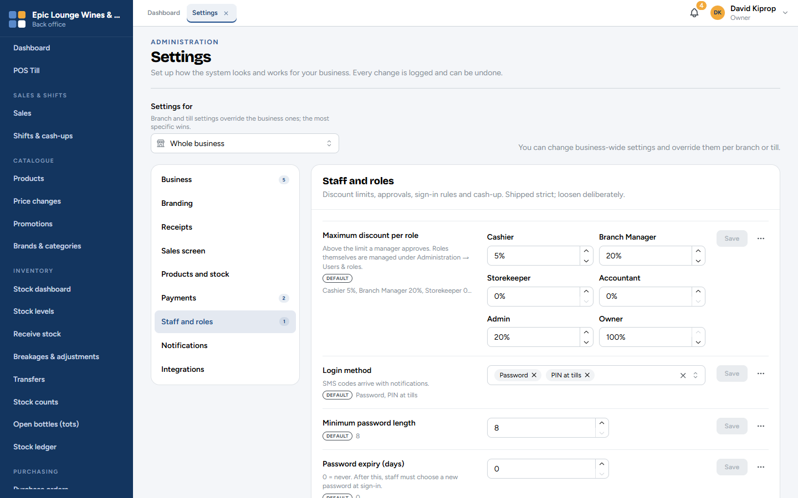

**Show**

- **Maximum discount per role:** Cashier 5%, Branch Manager 20%, Owner 100%. Above the limit, a manager approves with their PIN.
- **Login method:** a password for the back office, a PIN at the till.
- Password rules, plus (further down) idle sign-out, till lock and two-step login.

**Say:** "These start strict, and you loosen them on purpose. A cashier can't give away more than you allow."

## 10. Notifications: what you hear about

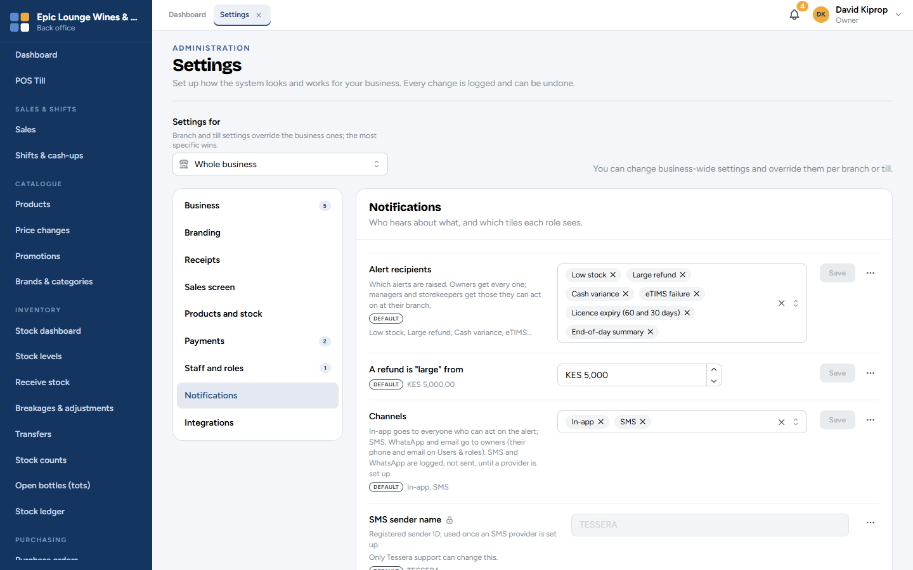

**Show**

- **Alerts:** low stock, large refunds, cash variance, eTIMS failures, licence expiry (60 and 30 days before) and the end-of-day summary.
- **A refund is "large" from:** KES 5,000.
- **Channels:** alerts appear in the app under the bell for everyone who can act on them.

**Say:** "You choose what is worth interrupting you for. Owners get every alert; a manager gets the ones for their branch."

## 11. Integrations: eTIMS and the till hardware

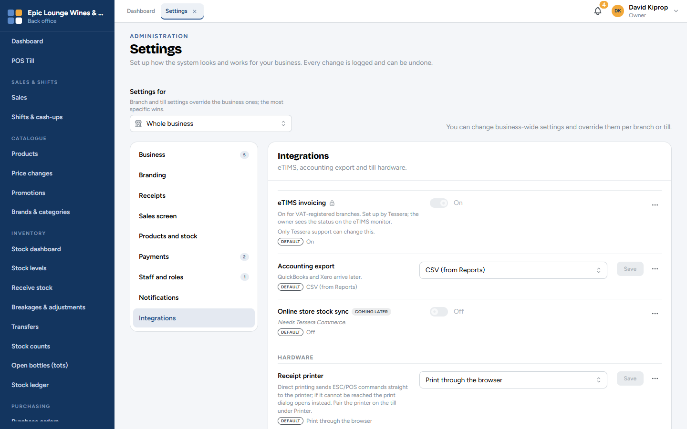

**Show**

- **eTIMS invoicing:** on, and locked. Tessera sets it up, and the owner follows it on the eTIMS monitor.
- **Accounting export:** CSV from Reports.
- **Receipt printer:** print through the browser, or print directly to a USB receipt printer, which can also open the cash drawer.

**Say:** "Every sale goes to KRA automatically. You never fill in eTIMS by hand."

## Questions clients often ask

| Question | Answer |
| --- | --- |
| Can a manager change prices here? | No. Prices are set under Catalogue → Price changes and approved by the owner. |
| What if someone changes a setting by mistake? | **⋯ → History** shows who changed it; **Undo last change** puts it back. |
| Can each till work differently? | Yes. Choose the till under **Settings for**, then change only what should differ. |
| Why are some settings greyed out? | A lock means Tessera support sets it (for example eTIMS), or it is locked after the first sale. *Coming later* means the feature is not available yet. |
