# Your questions from the demo

Answers for Epic Lounge Wines & Spirits on three things raised during the demo:

1. Giving the customer the bill first, and taking payment after.
2. A customer who changes their mind after being served (a Captain Morgan sent back for a Hunter's).
3. Borrowing a drink from a neighbour when the shop has run out.

The pictures are from the real system, set up as Epic Lounge.

**The rule behind all three answers:** stock and money only move when a sale is **completed** (paid). Anything before that is a draft on the till. Once a sale is completed it is never edited or deleted. A mistake is corrected with a return or another document, so the records always add up and the owner can see every step.

## 1. The bill first, payment after

In a lounge the customer usually sees the bill before paying. The till does this with **Print bill**.

### Step 1: add the drinks and print the bill

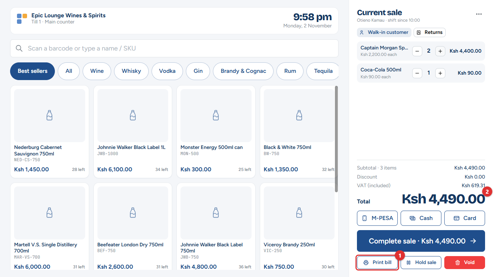

The waiter or cashier adds the drinks as usual. The total **(2)** is worked out straight away, with promotions and VAT. Pressing **Print bill (1)** prints the bill for the customer.

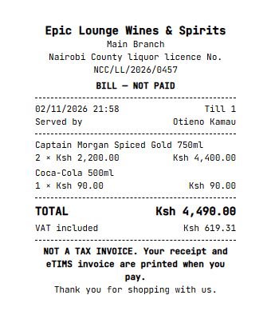

The bill shows the drinks, the total and the VAT. It is clearly marked **BILL — NOT PAID** and **NOT A TAX INVOICE**:

- It has **no receipt number** and **no payments**.
- It is **not sent to KRA** (no eTIMS).
- **Nothing is recorded**: no stock leaves the shelf, and no money is counted. The bill can be printed again as often as needed, for example after the customer adds a round.

### Step 2: hold the sale while the customer drinks

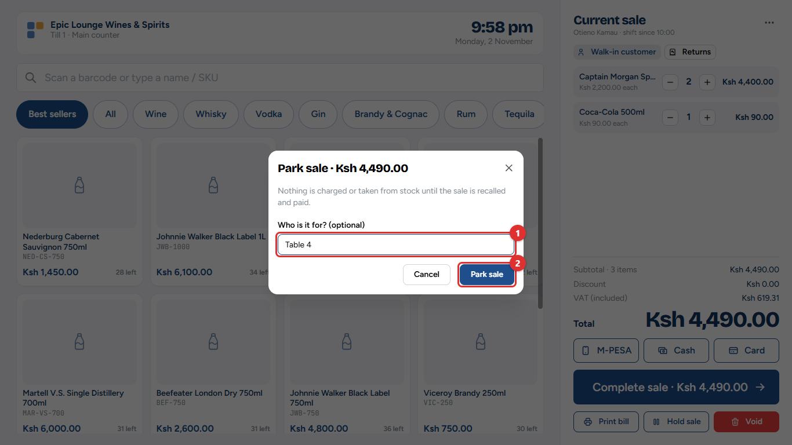

If the customer will pay later, press **Hold sale** and write who it is for **(1)**, for example *Table 4* or *Man in blue shirt*. Then press **Park sale (2)**. The till is free at once for the next customer.

### Step 3: when the customer is ready to pay, open the sale again

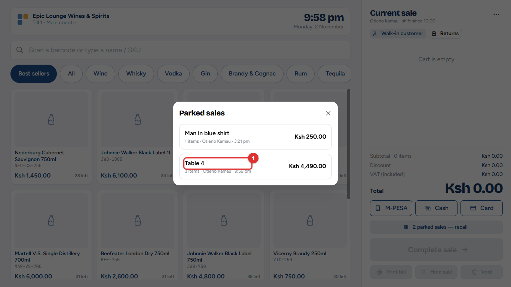

Open the till menu (**⋯**) and choose **Recall parked sale**. Tap the customer's sale **(1)**. Everything comes back exactly as it was. More drinks can still be added, and a new bill printed.

### Step 4: take the payment

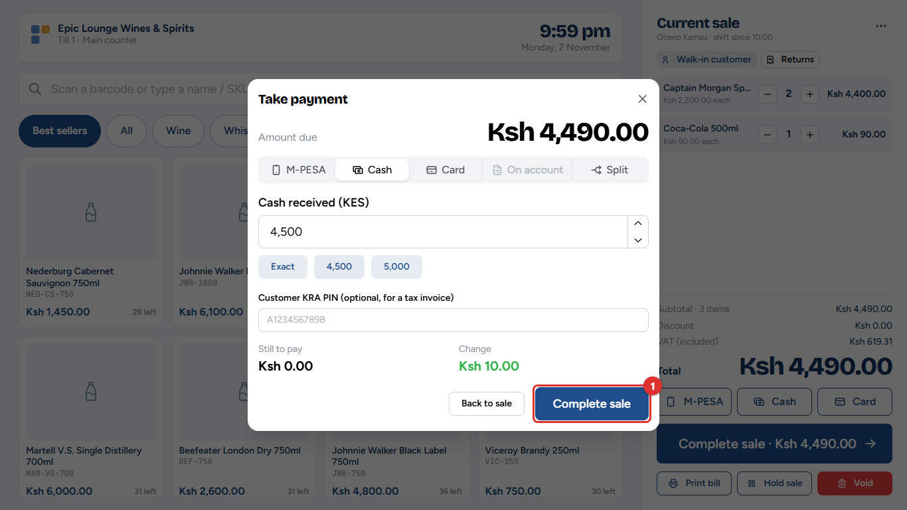

Press **Complete sale**, choose how they pay (M-PESA, cash, card or a split), and press **Complete sale (1)**.

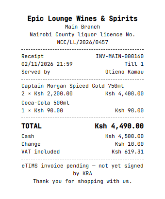

**Only now** is the sale recorded:

- The real **receipt** prints, with its receipt number, the payment and the change.
- The **eTIMS invoice** goes to KRA. "Pending" turns into the signed KRA invoice within moments, and a copy can be reprinted at any time.
- The bottles leave stock, and the money counts towards the shift's cash-up.

**Good to know**

- Several customers can be held at the same time, each under their own name.
- A held sale stays on the till until it is paid or voided. **A shift cannot be ended while a sale is still held**, so an unpaid table is never forgotten at closing.

## 2. The customer changes their mind (Captain Morgan → Hunter's)

What happens depends on whether the customer has **paid** yet.

### Before paying (the usual case in a lounge)

Because nothing is recorded until payment, a swap is simple.

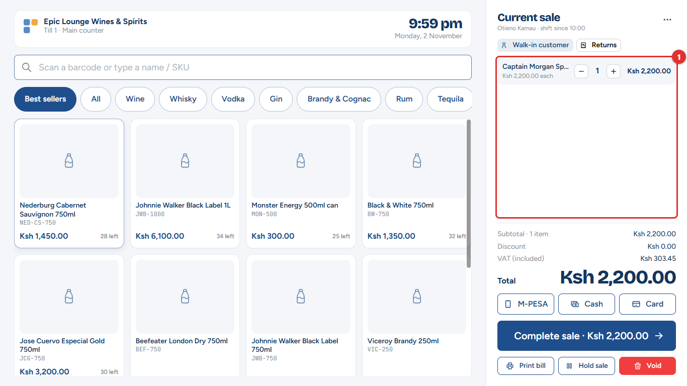

The Captain Morgan is on the sale **(1)**. The customer sends it back.

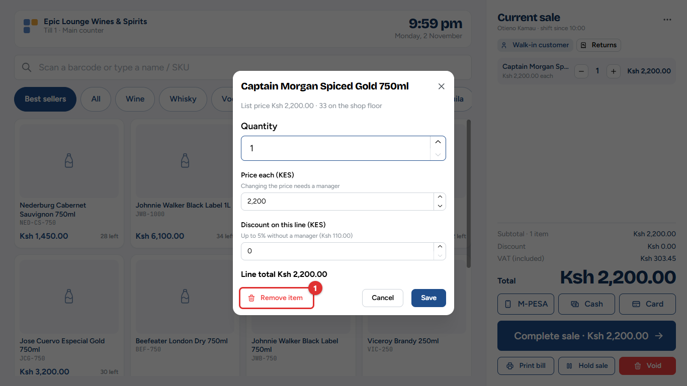

Tap the line and press **Remove item (1)**. (The **−** button does the same for one bottle at a time.)

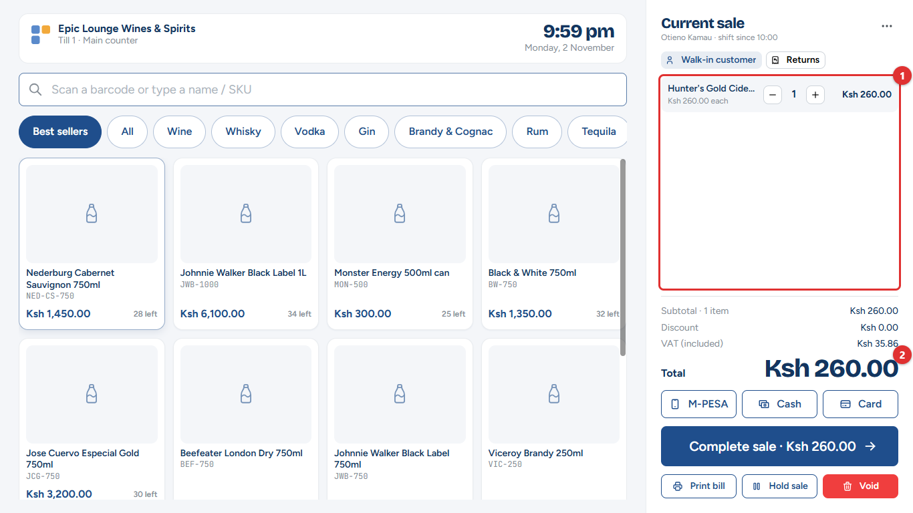

Add the Hunter's. The sale now shows only the Hunter's **(1)**, and the total **(2)** is updated at once. Print a fresh bill if the customer already has one.

**Effect on the system**

| | What happens |
|---|---|
| **Stock** | No change for the Captain Morgan: it was never sold, so it is still counted on the shelf (put the bottle back there). The Hunter's leaves stock when the sale is paid. |
| **Money** | The customer pays only for the Hunter's. The shift's expected cash is based on what was actually paid, so the cash-up still balances. |
| **Control** | Every removed item is written to the **audit log** (Administration → Audit log) with the cashier, the till, the item, the amount and the time, so the owner can see what was taken off sales. If the owner wants, removing an item can need a manager's PIN: always, or only above an amount (**Settings → Staff and roles → Remove an item from an open sale**). |

### After paying

Once the sale is paid, it is final and is never edited. The swap is done in two steps:

1. **Return the Captain Morgan** against its receipt: till menu → **Return / reprint** (or the **Returns** button), type the receipt number and choose the bottle. The cashier says whether the bottle is **sealed** (it goes back on the shelf to sell again) or **opened** (it goes to *Quarantine*, so it is not sold by mistake). A manager approves the refund with their PIN.
2. **Sell the Hunter's** as a new sale.

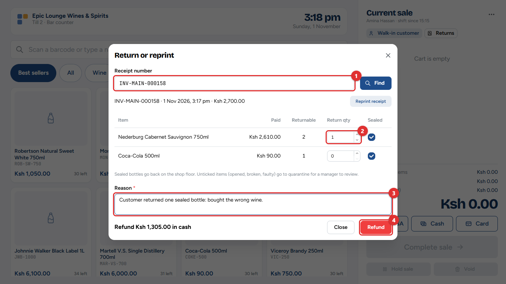

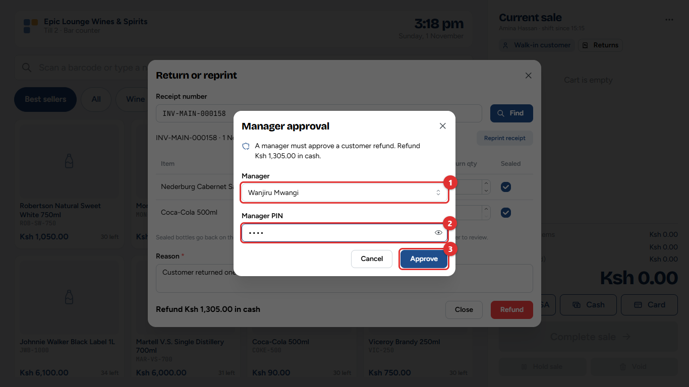

**Effect on the system:** the first sale stays as it was. The return is its own record, linked to the receipt, with the refunded amount and the stock movement. A credit note goes to KRA for the eTIMS invoice. The stock, the money and the KRA records all match, and the owner sees exactly what happened in the reports.

**Tip:** in a lounge it is best to keep the sale open (held) until the customer pays. Then a change of mind is just a swap on the till.

## 3. Borrowing from a neighbour when you have run out

This works with what the system has today. It has three parts: selling the drink, recording the borrowed bottles, and paying the neighbour back.

### Part 1: sell the drink, even if the system shows none on the shelf

When a sale needs more bottles than the system shows on the shelf, the till asks for a **manager's approval**. In the example below the shelf shows 7 bottles of Four Cousins Rosé, the customer's group wants 9, and 2 are borrowed from next door.

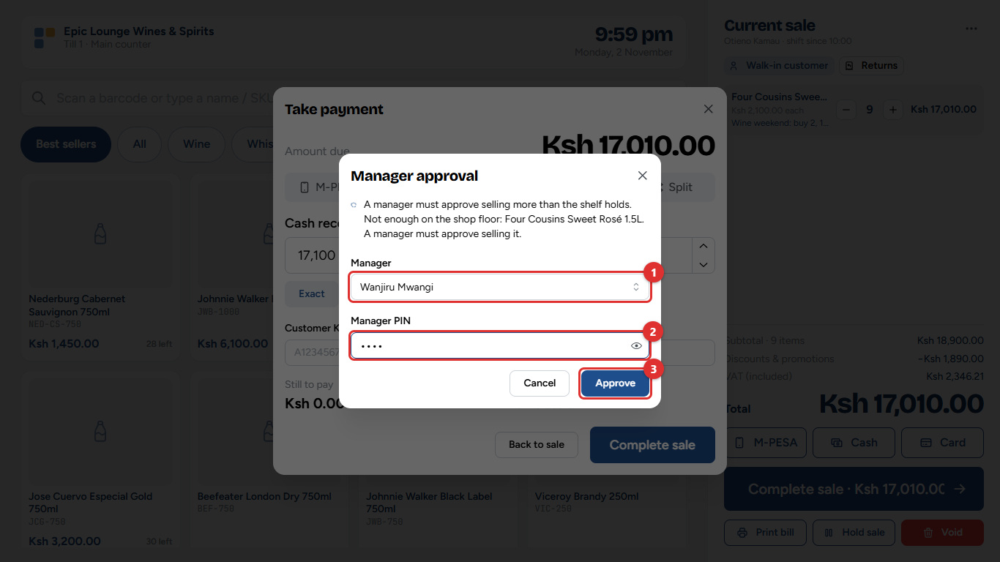

The manager picks their name **(1)**, enters their PIN **(2)** and presses **Approve (3)**. The sale goes through. The system records who approved it, and for a moment the shelf shows **−2**, so nobody can hide a shortfall.

This rule is a setting the owner controls:

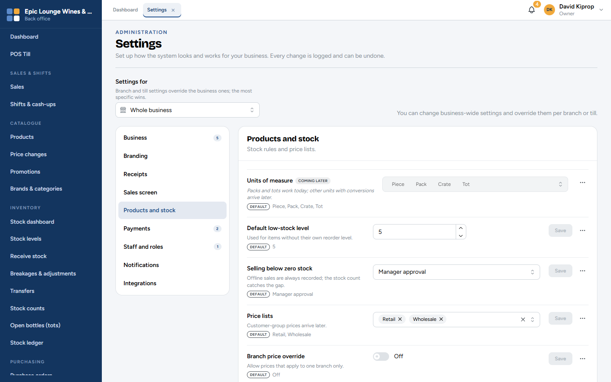

**Selling below zero stock** can be:

- **Manager approval** (the default, recommended),
- **Allowed** (no approval needed), or
- **Blocked** (the till refuses the sale).

### Part 2: record the borrowed bottles

So that stock and costs stay correct, the borrowed bottles are brought in like a small delivery:

1. Add the neighbour once as a **supplier** (Purchasing → Suppliers), for example *"Neighbour: Mama Njeri Wines"*.
2. Create a **purchase order** to that supplier for the bottles borrowed, at the price agreed (or at cost). The owner or manager approves it.
3. On **Receive stock**, receive the order. The shelf goes back from −2 to 0, and the bottles are on record as having come from the neighbour.

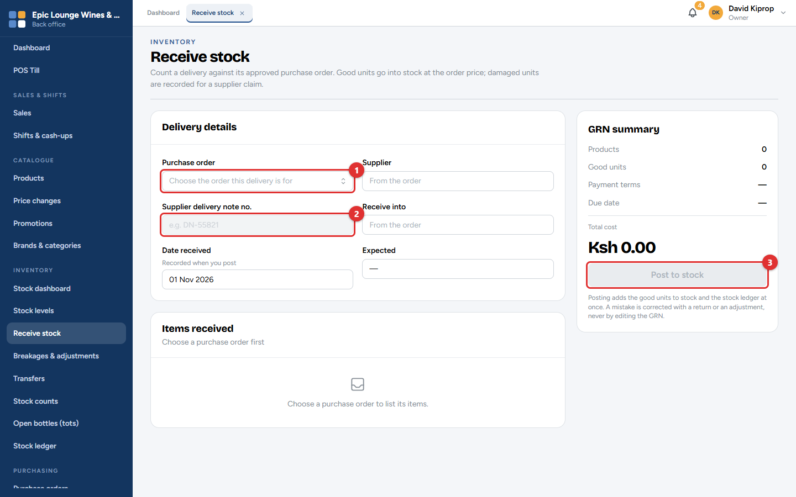

### Part 3: pay the neighbour back

Choose whichever matches the agreement:

- **Pay in money:** record the neighbour's invoice and the payment, like any other supplier. The supplier statement shows what is still owed.
- **Give bottles back in kind** (when your own delivery arrives): use **Returns to supplier** for the same bottles. Another person approves it, the bottles leave stock, and the neighbour's balance is cleared.

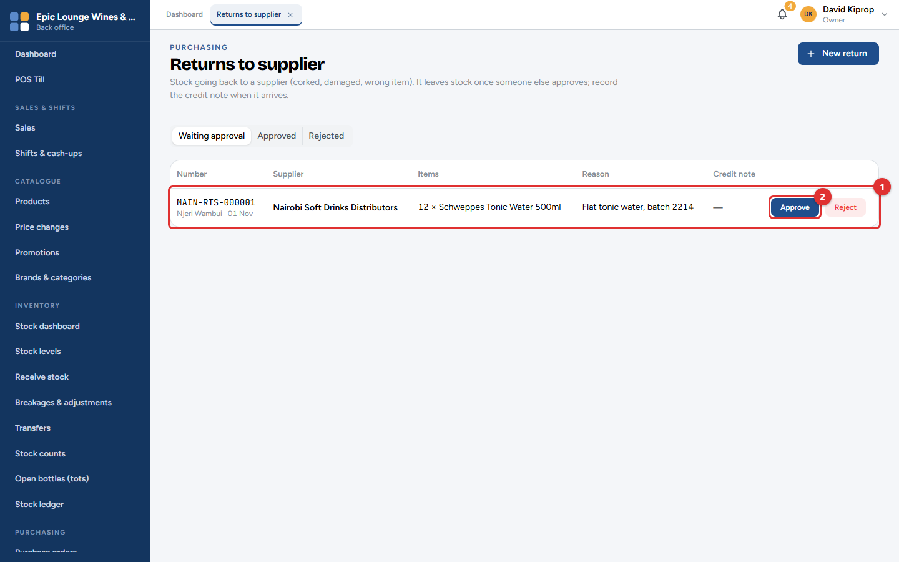

**Effect on the system**

| | What happens |
|---|---|
| **Stock** | Correct at every step: −2 after the sale, 0 after the borrowed bottles are received, and lower again if bottles are given back. |
| **Money** | The sale is recorded in full. What the shop owes the neighbour shows on the supplier account until it is paid or returned. |
| **Control** | Every step carries a name and an approval: who sold below zero, who approved the order, who received the bottles. |

**A possible next step:** if borrowing and lending between neighbours happens often, a simpler one-screen "borrow / lend" record with a running balance per neighbour can be added later. It is not part of the current scope; tell us if it would help.

## In short

| Question | Answer |
|---|---|
| Bill before paying? | **Print bill**, then **Hold sale**. Recall the sale and **Complete sale** when the customer pays. Only then do the receipt and the eTIMS invoice print, and only then do stock and money move. |
| Change of mind before paying? | Remove the item and add the new one. Stock is not affected, the total updates, and the removal is written to the audit log. |
| Change of mind after paying? | **Return** the first drink with its receipt (manager approves), then sell the new one. |
| Borrowing from a neighbour? | A manager approves selling below zero. Receive the borrowed bottles from the neighbour as a supplier. Pay them back by invoice or with bottles returned to them. |
